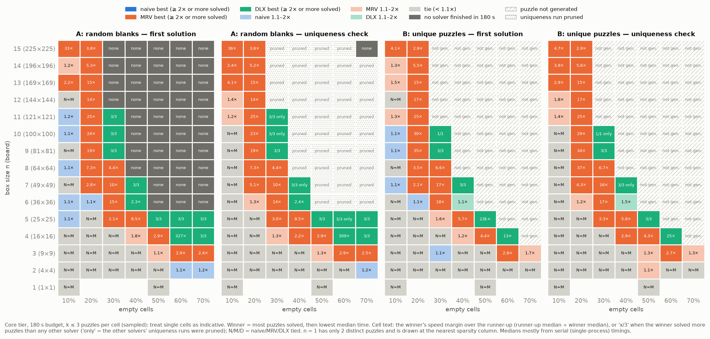
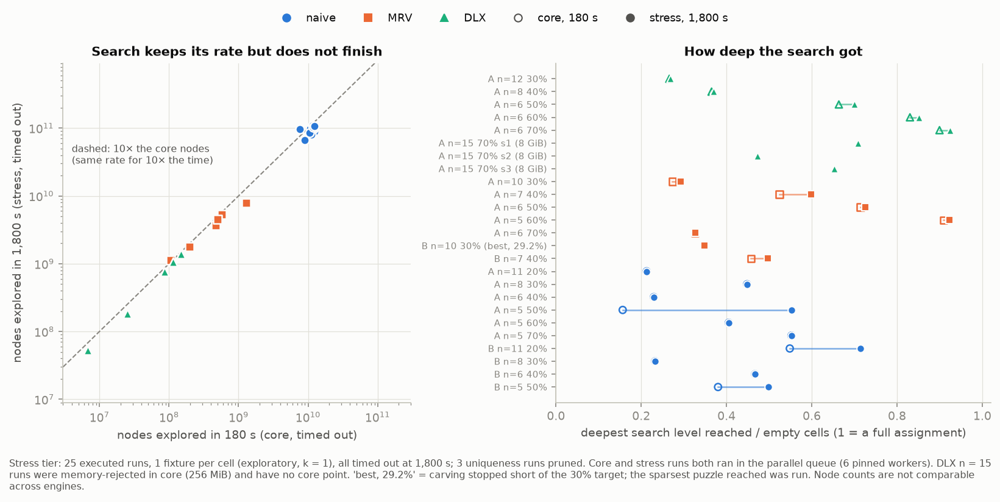

# Step 10 — performance conclusions (final)

*This is the closing report of Step 10. It draws only on measurements:*
- *the core campaign at 180 s ([analysis.md](analysis.md), `figures/core/`);*
- *profiling ([profiling.md](profiling.md));*
- *the stress tier at 1,800 s (§4 below, `figures/stress/`).*

*Each claim cites its source. Claims that rest on censored data (timeouts) or on k = 1 are
labelled as such. No solver code was changed during Step 10.*

## Summary

| Question | Answer | Confidence |
|---|---|---|
| Which solver for typical puzzles? | **MRV**: at 10% empty its median paired ratio to naive is 0.96–0.97 (worst cell 0.84), and it pulls far ahead as soon as backtracking starts. DLX is 28× slower (median) | High: serial timings, every cell 3/3 completed |
| Which solver for hard puzzles? | **DLX**: the most completions (A 174/300, B 160/160), 23 completions MRV missed and 0 the other way | Medium: k = 3 per cell, censored at 180 s |
| Should MRV stay the default? | **Yes** | High for typical use |
| Is adaptive selection worth building? | **Not yet.** Fix DLX's per-node scan first (candidate 1); then re-measure | Reasoned from profiling, not measured |
| Are the walls a budget artifact? | **No evidence of that.** All 25 stress runs at 10× the budget timed out again, and the search was no deeper | Exploratory (k = 1 per cell) |

## 1. Winner by workload, and scaling

| Region | Winner | Evidence |
|---|---|---|
| **Easy:** 10–20% empty, any n | MRV ≈ naive ≫ DLX | Median MRV/naive ratio 0.97 (A) and 0.96 (B) at 10%. DLX slower at every 10% cell: median 28×, up to 70–90× at n = 13–15 (67 ms vs 0.9 ms at n = 15) — analysis.md §1, [Fig. 4](../figures/core/fig04_speedups_A.png) |
| **Medium:** naive starts backtracking heavily (20% at n ≥ 7, n = 15 at 10%) | MRV | MRV up to 14,600× over naive (A, n = 10, 20%); 59 completions naive missed, 1 the other way — analysis.md §2 |
| **Hard:** small n at 40–70%, unique puzzles near the generation frontier | DLX | 4.5× (A n = 6, 40%), 60× (A n = 4, 70%), 2,400× (A n = 5, 70%) over MRV where both finished; 23 censored wins, 0 losses; every generated B puzzle solved, both ops — analysis.md §2 |
| **Beyond the wall:** A at ≥ 30% for n ≥ 12, ≥ 40% for n ≥ 8, ≥ 50% for n ≥ 6 | none | No solver completes at 180 s ([Fig. 3](../figures/core/fig03_runtime_heatmap_A.png)) or at 1,800 s on the stress shortlist (§4) |

**Best solver per cell** (`scripts/plot_winner.py`; table in `results/core/summary/best_solver.csv`):
- **Rule:** in each cell, the solver that completed the most puzzles wins, then the one with
  the lowest median time; margins under 1.1× count as ties.
- **Reading it:** at k ≤ 3 puzzles per cell, single cells are indicative only.



**Scaling.**
- **With n, at fixed easy sparsity:**
  - The backtracking solvers' cost per node stays flat: naive 0.02–0.09 µs, MRV 0.05–0.18 µs.
  - DLX's cost per node grows with the board area: 0.22 µs at n = 3, 13 µs at n = 15.
  - The reason is that DLX's `chooseColumn()` scans every open column, 2 × the empty
    cells, at about 1.31 ns per column. That scan is 77–94% of DLX's time (profiling.md
    H1).
- **With sparsity, at fixed n:** runtime is set by tree size, not by board size. Each solver
  hits a sharp completion wall rather than a gradual slowdown:
  - the [fraction-solved curves](../figures/core/figC3_fraction_solved.png) plateau well
    below 1;
  - the 40 serial confirmations all timed out again;
  - the stress tier did not move the wall (§4).
- **Uniqueness vs first solution:** the cost ratio is a median 1.05 (IQR 1.01–1.11, max
  3.2) where both ran. This is biased toward easy fixtures, because uniqueness runs were
  pruned behind first-solution timeouts (analysis.md §4).

## 2. Extreme cases

| Case | Observation | Source |
|---|---|---|
| Largest DLX loss | About 90× slower than MRV on easy n = 13–15 boards | analysis.md §1 |
| Largest DLX win | 8,400× faster than MRV on A-n04-e000179-s001: 67,138× fewer nodes ÷ 8× the per-node cost | profiling.md H2 |
| Largest MRV win over naive | 14,600× (A, n = 10, 20%) | analysis.md §2 |
| Equal trees | A-n15-e010125: 10,125 nodes each; DLX 270 ms vs MRV 74 ms, which isolates per-node cost | profiling.md H1 |
| DLX memory | Peak about 251 MiB at n = 15, 70% (estimate 261 MiB): over the shipped 256 MiB budget, so `memory_rejected` in core. At 8 GiB it built in 0.08–0.10 s and then timed out | analysis.md §5; §4 below |
| Naive and MRV memory | Under 2 MiB above baseline at every size | [Fig. 6](../figures/core/fig06_memory_vs_n.png) |
| Throughput at the wall | Nodes per second on the stress timeouts: naive 3.7–6.1 × 10⁷; MRV 0.5–4.4 × 10⁶; DLX 4–8 × 10⁵ at n = 6, 1 × 10⁵ at n = 8, 3 × 10⁴ at n = 12, 1–1.6 × 10⁴ at n = 15 | `results/stress/summary/stress_vs_core.csv` |

## 3. Recommendations

**MRV should stay the default.**
- It wins or ties on the workloads users actually submit: puzzles with clues that propagate,
  at any size.
- It never trails naive by much (worst paired ratio 0.84).
- It needs negligible memory.

**DLX pays off** only when the search tree, not the per-node cost, dominates:
- unique puzzles of high sparsity at small and medium n;
- generation-time uniqueness checks near the minimal-clue frontier, which is the use already
  made of it in population B carving.

On easy large boards it is 1–2 orders of magnitude slower. It also needs a memory budget
that scales with N³ and reached 251 MiB at n = 15, 70%.

**Adaptive selection is not worth building yet.**
- The crossover sits in a narrow band, sampled at k = 3.
- Its cause is understood, and it is fixable inside DLX:
  - optimisation candidate 1 (stop the column scan on a size-1 column) attacks the 77–94% of
    DLX time that the scan costs on easy boards;
  - candidate 2 (size buckets) removes the scan entirely.
- If DLX's easy-board penalty disappears, DLX could simply become the default and adaptive
  selection would be moot.
- If a gap remains after candidates 1–4, revisit adaptive selection with deep sampling
  (k ≥ 20) in the crossover band. A cheap selector input would be the initial forced-cell
  count, which every fixture already records.

## 4. Stress tier (1,800 s, exploratory)

The approved shortlist ([stress_shortlist.md](stress_shortlist.md)) was 25 groups:
- 22 frontier cells (seed 1, first op): for each (population, solver, sparsity), the first n
  at which all 3 core seeds failed;
- 3 DLX memory rejections (A, n = 15, 70%, seeds 1–3), rerun with an 8 GiB budget.

Every run used 6 pinned workers, the same concurrency as the core runs it is compared with.
The tier took 12.5 process-hours, inside the 14.9 CPU-h worst case.

**Result: 25 executed runs, 25 timeouts, 0 completions; 3 uniqueness runs pruned.**



- **No soft wall found.** No frontier cell completed between 180 s and 1,800 s, so there is
  nothing to confirm serially (the threshold was 1,440 s). A timeout at k = 1 is
  *consistent with* a hard wall; it does not prove one.
- **The search keeps its rate, but makes no progress toward a solution:**
  - each run explored 6.2–12.8× the nodes of its own 180 s core run (median 8.7×; left
    panel), so throughput held roughly steady over 10× the time;
  - the deepest level reached barely moved: of the 21 runs with a core counterpart, 18
    gained less than 0.08 of the empty cells and 8 gained nothing at all. The median depth
    reached was 0.50 of the empty cells (right panel);
  - three naive runs went deeper (A n = 5, 50%: +0.40; B n = 11, 20%: +0.17;
    B n = 5, 50%: +0.12) and still did not finish.

  This is what an exponential tree looks like: ten times the time buys about one more level
  of search.
- **DLX at n = 15, 70% with 8 GiB:**
  - **memory:** the matrix built in 0.08–0.10 s, with a peak of about 251 MiB against the
    261 MiB estimate, so the 256 MiB rejection was a budget decision, not a capacity problem;
  - **result:** all three seeds timed out, reaching 47–71% of the empty cells;
  - the shipped budget therefore cost no completion on these fixtures.
- **Deviation, B/MRV/30% cell.** The mechanical selection took seed 1 at
  B-n10-e003000. That seed's carving stopped at 2,923 empty cells (29.2%,
  `target_not_achieved`), so `sudoku_bench` ran its sparsest reached puzzle (`.best.txt`),
  not a 30% fixture. MRV timed out on it; the cell's only on-target fixture (s003) had already
  timed out in core. The figure labels the run "(best, 29.2%)", the table gives its
  `fixture_status` and `fixture_empty`, and the README changelog records it.

Table: `results/stress/summary/stress_vs_core.csv`. Script: `scripts/plot_stress.py`.

## 5. Optimisation candidates (documented, not applied)

These come from profiling.md; their order follows the expected payoff.

| # | Candidate | Targets | Check before adopting |
|---|---|---|---|
| 1 | DLX `chooseColumn()` returns early on a size-1 column | Easy-board penalty: 77–94% of DLX time | Node counts before and after; a later size-0 column can now be found one level deeper |
| 2 | DLX columns bucketed by size, O(1) minimum | Removes the scan entirely | Upkeep cost in `cover()`/`uncover()`; link updates are cheap and cache-resident (H3) |
| 3 | MRV incremental candidate counts, or a priority structure | Full scan on hard boards (about 97% of samples) | Overhead on easy boards, where the scan already exits after 1–11 cells |
| 4 | MRV hidden-single detection | Tree size on hard boards, closer to DLX | Per-node cost; ablation against current MRV |
| 5 | Adaptive selection | Whatever gap remains after 1–4 | Deep sampling in the crossover band |

None of these would move the population-A walls in §4 by more than a constant factor. Only
stronger inference (more pruning per node) changes tree size.

## 6. Remaining uncertainties

- **Sample size:**
  - Core cells have k = 3, and stress cells k = 1.
  - A 2/3 completion rate has a Wilson 95% interval of 0.21–0.94.
  - No p95, runtime distributions or candidate-count regressions were possible; deep sampling
    was deferred.
- **Censoring:**
  - Completions between 1,800 s and infinity are invisible.
  - 59 parallel borderline timeouts in core were not confirmed serially. They keep their
    parallel outcome; the calibrated slowdown is 1.06× mean and 1.15× worst.
- **Population B gaps:** unique puzzles do not exist (were not generated) past the wall,
  exactly where the solvers differ most. Whether unique puzzles there are harder or easier
  than population A is unknown.
- **Population A bias:** grids come from one pattern family. The pilot ablation (k = 1)
  flagged a possible bias ([schedule.md](schedule.md) §3):
  - at n = 4, MRV was about 12× faster and naive about 3× faster on solver-filled grids;
  - at n = 3, and for DLX at both sizes, the two grid sources agreed (0.83–1.14).

  The 3-seed follow-up proposed there was not run. So the absolute backtracking times on
  population A may be pessimistic, and the DLX-vs-MRV gap on A may be overstated. Population B
  uses the same grids, so it does not settle this either.
- **Mechanism vs ablation:** H2 (DLX's hidden-single branching) rests on tree-size
  measurements plus the known exact-cover property. No MRV-with-hidden-singles variant was
  built.
- **One machine:** a Ryzen 5 7600X under Windows 11 and GCC 14.2. The relative results
  (tree sizes, scan costs) should carry over; absolute times will not.
- **Not measured:** the `LogicalSolver`, which was deferred at the user's request.

## Reproduce

```
python benchmarks/scripts/run_campaign.py --tier custom --name stress --jobs-file benchmarks/reports/stress_jobs.csv --workers 6
python benchmarks/scripts/summarize.py --tier stress
python benchmarks/scripts/plot_stress.py
python benchmarks/scripts/plot_winner.py
```
Core and profiling: see [analysis.md](analysis.md) and [profiling.md](profiling.md).
