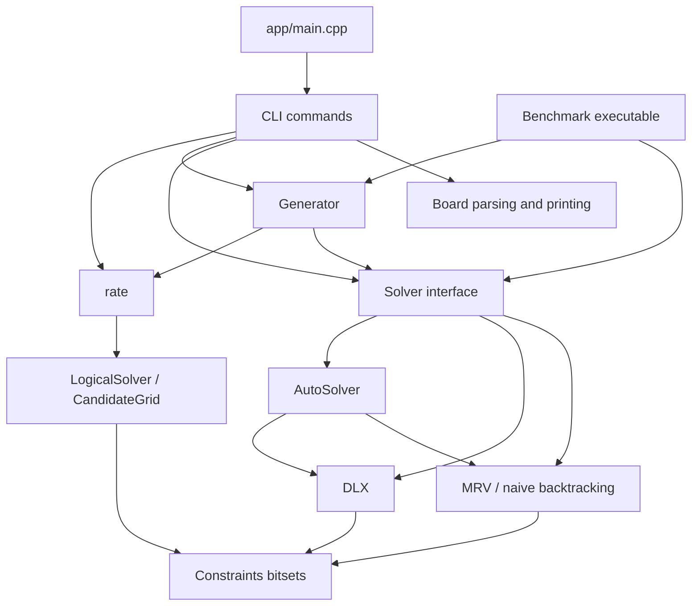

# Code-level explanation of Cpp_Sudoku

This is a walkthrough of the handwritten code present on **November 6, 2026**, including the automatic solver selector and the Step 12 difficulty hardening. It explains files, types, functions, important expressions, control flow, tests, and benchmark scripts. It is a reference to the implementation, not a proposed redesign.

“Every piece” here means every handwritten source/configuration file and its meaningful components. Repeated includes, braces, individual fixture digits, compiler-generated sources, object files, executables, and thousands of recorded measurement rows are not explained line by line. Their roles are covered separately. Each registered C++ test is listed in the final catalog.

## Contents

1. [The overall system](#1-the-overall-system)
2. [Build and editor configuration](#2-build-and-editor-configuration)
3. [Board representation and parsing](#3-board-representation-and-parsing)
4. [Constraints, randomness, and deadlines](#4-constraints-randomness-and-deadlines)
5. [The common exact-solver API](#5-the-common-exact-solver-api)
6. [Backtracking: naive and MRV](#6-backtracking-naive-and-mrv)
7. [Dancing Links](#7-dancing-links)
8. [Automatic solver selection](#8-automatic-solver-selection)
9. [Logical solving](#9-logical-solving)
10. [Difficulty grading](#10-difficulty-grading)
11. [Puzzle generation](#11-puzzle-generation)
12. [Events and text traces](#12-events-and-text-traces)
13. [Command-line application](#13-command-line-application)
14. [Test framework and test code](#14-test-framework-and-test-code)
15. [C++ benchmark executable](#15-c-benchmark-executable)
16. [Python benchmark pipeline](#16-python-benchmark-pipeline)
17. [Data, reports, and generated files](#17-data-reports-and-generated-files)
18. [End-to-end execution examples](#18-end-to-end-execution-examples)
19. [Important implementation contracts](#19-important-implementation-contracts)
20. [Complete test catalog](#20-complete-test-catalog)

## 1. The overall system

The project has four main jobs:

- **Exact solving:** find a solution, count solutions, or establish uniqueness by searching.
- **Logical solving and rating:** apply named human-style deductions, then optionally guess when the implemented techniques stall.
- **Generation:** construct a complete grid and remove clues while preserving uniqueness, optionally targeting a difficulty.
- **Experimental measurement:** generate fixed workloads, run independent solver processes, validate answers, and summarize performance.

The units used throughout the code are important:

| Symbol/concept | Meaning | Standard Sudoku |
|---|---|---|
| `n`, `boxSize` | Side length of a box | 3 |
| `N`, `size()` | Board side length, `n * n` | 9 |
| `cellCount()` | Number of cells, `N * N = n^4` | 81 |
| `cell` | Flat row-major index, `row * N + col` | 0 through 80 |
| `value` | Zero for empty; otherwise 1 through N | 0 through 9 |
| `unit` | A row, column, or box | 27 units |

In the logical solver, units are numbered as rows `0..N-1`, columns `N..2N-1`, and boxes `2N..3N-1`. In displayed traces, rows and columns become one-based names such as `r1c2`.



`include/sudoku/` declares the library interface. `src/` implements it. `app/` translates command-line arguments into library calls. `tests/` verifies behavior. `benchmarks/` is a separate measurement application and analysis pipeline.

### C++ conventions used throughout

- `#pragma once` prevents repeated inclusion of a header within one translation unit.
- `namespace sudoku` groups the library names; anonymous namespaces keep implementation helpers private to a `.cpp` file.
- `[[nodiscard]]` asks the compiler to warn when a meaningful return value is ignored.
- `const` member functions do not modify their object's ordinary data members. Exact solver objects keep per-run mutable state in separate search objects.
- `std::optional<T>` expresses absence without a special numeric sentinel. For example, no `firstSolution` means no solution board is available.
- `std::vector` owns dynamically sized storage; `std::span` is a non-owning view of contiguous storage.
- `std::move` allows transferring owned buffers instead of copying them. It does not itself move bytes; it enables move construction/assignment.
- Designated initializers such as `{.solutionLimit = 2}` name relevant fields and leave other members at their defaults.
- `if constexpr` selects code at compile time. Disabled tracing/counter branches disappear from the corresponding compiled search specialization.
- `std::chrono::steady_clock` measures elapsed time without depending on changes to the system's calendar clock.

## 2. Build and editor configuration

### `CMakeLists.txt`

The root build file requires CMake 3.20, declares project `Sudoku`, requires standard C++20, and disables compiler-specific language extensions. Single-configuration generators default to Release if no configuration was selected.

| Option | Effect |
|---|---|
| `SUDOKU_BUILD_TESTS` | Builds/registers unit, CLI, and property tests. |
| `SUDOKU_DLX_VALIDATE` | Enables expensive structural checks in the DLX engine. |
| `SUDOKU_SOLVER_COUNTERS` | Compiles fine-grained search counters into the solvers. |
| `SUDOKU_BUILD_BENCHMARKS` | Adds the benchmark executable. |

`sudoku_set_warnings(target)` applies `/W4 /permissive-` on MSVC or `-Wall -Wextra -Wpedantic -Wshadow` elsewhere. It is reused for every compiled target.

The targets form this dependency structure:

| Target | Inputs and purpose |
|---|---|
| `sudoku_core` | Eight implementation files: board, backtracking, DLX, automatic selection, generation, logical solving, difficulty, and text traces. Exports the include directory and C++20 requirement. |
| `sudoku_cli` | `app/cli.cpp`, linked to the core. Exporting this as a library lets tests run commands in process. |
| `sudoku` | `app/main.cpp`, linked to the CLI library. |
| `sudoku_tests` | `tests/test_main.cpp` and `tests/test_difficulty.cpp`, linked to the CLI and transitively the core. |
| `sudoku_property_tests` | `tests/property_tests.cpp`, linked only to the core. |
| `sudoku_bench` | Defined in the benchmark subdirectory; linked to the core. |

The DLX validation and counter definitions are `PUBLIC` because headers expose configuration-dependent constants. Consumers must see the same configuration as the library.

CTest registers the unit executable, five real CLI invocations, and the property executable. `cli_rejects_bad_input` uses `WILL_FAIL`, so a nonzero process result is expected. The property entry has labels `property;slow` and a 900-second timeout. The other entries have label `unit`.

### `benchmarks/CMakeLists.txt`

Builds `sudoku_bench` from `bench_main.cpp`, `common.cpp`, and `fixtures.cpp`. Windows links `psapi` for process-memory sampling. Compile definitions embed the configured build type and compiler flags into the executable's `env` output. `RUNTIME_OUTPUT_DIRECTORY` places the executable beside `sudoku`, rather than inside the benchmark build subdirectory.

### `.vscode/c_cpp_properties.json`

Configures VS Code IntelliSense for the MinGW GCC executable, the Windows GCC x64 ABI, C++20, C17, and project include paths. Its compilation-database path points to `build-cmake/compile_commands.json`; this is an editor setting, not an instruction that CMake itself builds into that directory. The root `CMakeLists.txt` does not set `CMAKE_EXPORT_COMPILE_COMMANDS`, so the file is not produced by the documented configure command, and the editor falls back to the explicitly listed settings. Configuring with `-DCMAKE_EXPORT_COMPILE_COMMANDS=ON` (Ninja and Makefile generators only) writes it, which gives IntelliSense the exact flags and definitions of each file.

## 3. Board representation and parsing

Files: `include/sudoku/board.hpp`, `src/board.cpp`.

### `Board` data and ordinary operations

`Board` owns `boxSize_`, `size_`, and `cells_`, a flat `std::vector<int>`. It deliberately owns no solver state or candidate masks. Copying a board copies its cell values; defaulted equality compares its members.

| Member | What it does |
|---|---|
| `Board(boxSize)` | Validates dimensions, calculates `size_`, allocates zero-filled cells. Default box size is 3. |
| `boxSize()`, `size()`, `cellCount()` | Return geometry; the constructor has already established that the products fit. |
| `usesCharacterFormat()` | Tests whether values fit the character alphabet, whose maximum is 35. Supported square sizes therefore use it through 25×25. |
| `get(row,col)` | Checks coordinates, then uses flat access. |
| `set(row,col,value)` | Checks coordinates and the value range `0..N`, then writes the cell. |
| `at(index)`, `setAt(index,value)` | Fast flat access. Debug assertions check the index. `setAt` does not check the value. |
| `boxIndex(row,col)` | Computes `(row / n) * n + col / n`. |
| `isValid()` | Uses `Constraints::fromBoard`; checks values and duplicate givens, not full solvability. |
| `isFilled()` | Checks that no cell is zero. This alone is not proof of validity. |
| `clueCount()` | Counts nonzero cells. |
| `operator==` | Compares geometry and all stored values. |

`checkBoxSize()` uses 64-bit multiplication for `n*n`, then division to check whether squaring again would exceed `int`. Checking `size > INT_MAX / size` avoids overflowing while testing for overflow. Invalid nonpositive box sizes throw `invalid_argument`; dimensions too large for the index type throw `length_error`; allocation can throw `bad_alloc`.

### Text conversion helpers

- `valueToChar`: converts zero to `.`, 1–9 to digits, and 10–35 to A–Z.
- `charToValue`: accepts `.`, `0`, digits, and letters case-insensitively; returns `-1` for unrecognized characters.
- `isSpace` casts to `unsigned char` before calling `isspace`, as required for safe use with arbitrary input bytes.
- `isSeparator` recognizes `|`, `-`, and `+` as formatting separators.
- `gridName` formats dimensions for diagnostics.
- `tooLarge` formats an out-of-range cell-value error.
- `boardFrom` constructs a board and copies already-validated values into it through `setAt`.

### Inferring dimensions

`boxSizeForCellCount(count)` searches for an integer `n` satisfying `n^4 == count`. A floating-point fourth-root estimate narrows the search, but nearby candidates are checked with integer arithmetic. The floating-point result is not accepted as proof. Zero cells are rejected, and integer products are guarded against overflow.

### Number-format parsing

`tokens(text)` divides input at whitespace and the three box-separator characters, returning views into the original string. `NumberScan` stores parsed values and three diagnostic facts: whether tokens look numeric, whether they obey the no-leading-zero rule, and the first problem encountered.

`scanNumbers(tokens,maxValue)` accepts `.` and `0` as empty, otherwise requires decimal digits. It rejects leading zeros on multi-digit tokens. It builds values incrementally and stops as soon as they exceed the legal maximum, so extremely long number tokens do not need to overflow an integer. Invalid numeric tokens are represented by `-1` only inside the temporary scan result, not accepted into a successfully parsed board.

### Character-format parsing

`CharacterScan` collects one value per non-separator, non-whitespace character and remembers the first invalid character. `scanCharacters()` delegates decoding to `charToValue`.

### `Board::parse`

The parser tries the numeric interpretation first, but only accepts it if the token count is a fourth power and all values fit the inferred board. Otherwise it tries the character interpretation. This fallback preserves compact inputs and rows containing leading zeros. If neither interpretation works, it chooses an error message based on which format the input most resembles.

For example, the sixteen dots in `................` form a 4×4 board even though they are one whitespace-delimited token. A whitespace-separated sequence of multi-digit values can represent larger boards. `parse()` validates representation and ranges; duplicate givens can still produce a board whose `isValid()` is false.

### Printing

`toString()` returns one compact line: character cells for small boards, or space-separated decimal cells for boards too large for the alphabet. Empty cells are dots.

`toPrettyString()` calculates a cell width, formats each row, inserts vertical separators after boxes, and constructs horizontal separators from the first row's character positions. Its local `cellText` lambda handles character/number padding. Valid printed boards can be parsed back. These printers assume meaningful board values; the validation boundary is not automatically invoked on every access or print.

## 4. Constraints, randomness, and deadlines

### `include/sudoku/constraints.hpp`

`Constraints` stores three arrays of bitsets: used values for every row, column, and box. `Word` is `uint64_t`; `kWordBits` is 64. Value `v` occupies bit `v-1`.

For each unit there are `words_ = ceil(N/64)` words. `lastWord_` masks unused high bits in the last word. A 64×64 board needs one word per unit, while an 81×81 board needs two.

The central expression is:

```cpp
fullMask & ~(rowMask | columnMask | boxMask)
```

The OR marks values already used by any of the three units. Complementing selects unused values. The final AND discards bits that do not correspond to real values.

| Component | Explanation |
|---|---|
| Constructor | Calculates bitset dimensions and zero-initializes `rows_`, `cols_`, `boxes_`. Normal callers pass a box size already validated by `Board`. |
| `fromBoard` | Builds masks from givens. Skips zero, rejects out-of-range values, rejects duplicates, and returns an optional constraint state. |
| `Location`, `locate(value)` | Map a value to word index `(v-1)/64` and bit `1 << ((v-1)%64)`. Callers must supply valid positive values. |
| `canPlace` | Checks whether that bit is absent from the three relevant units. |
| `place` | Sets the value bit in all three units. |
| `remove` | Clears it in all three units. This relies on legal placement history; it is not a reference-counted multiset of duplicate values. |
| `candidateCount<kWords>` | Applies the candidate expression word by word and sums `std::popcount`. |
| `appendCandidates<kWords>` | Appends ascending candidate values to an existing vector. Does not clear the vector. |
| `candidates` | Allocates a fresh vector and delegates to `appendCandidates`. |
| `wordCount<kWords>` | Uses the template constant when nonzero, otherwise the runtime width. |
| `free<kWords>` | Returns a full-word mask or the partial last-word mask. The one-word specialization needs only `lastWord_`. |
| `units`, `offset`, `box` | Calculate allocation lengths and offsets. |
| `rowWords`, `colWords`, `boxWords` | Const/non-const pointer views into the relevant contiguous masks. |

Candidate enumeration uses `std::countr_zero(m)` to locate the lowest set bit. `m &= m-1` clears that bit. Repeating visits only actual candidates rather than testing every possible bit.

### `include/sudoku/random.hpp`

`Rng` aliases `std::mt19937_64`. Its seeded output sequence is specified, but standard-library distribution/shuffle implementations can differ. The project therefore implements those two operations itself.

`uniformBelow(rng,bound)` uses rejection sampling. For positive `bound`, unsigned arithmetic computes `threshold = (0-bound) % bound`, equivalent to `2^64 % bound`. Numbers below the threshold are discarded; the remaining range has a size divisible by `bound`, making `r % bound` unbiased.

`shuffle(span,rng)` is Fisher–Yates: walk backward and swap each last remaining element with a uniformly selected element of the remaining prefix. The span allows shuffling a whole vector or a candidate slice without copying.

### `include/sudoku/deadline.hpp`

`Deadline` is a cooperative stop condition, not a timer interrupt or background thread.

| Method/state | Explanation |
|---|---|
| Default construction | No deadline. |
| `at(time_point)` | Stores an absolute steady-clock expiry. |
| `after(milliseconds)` | Converts a positive duration to an expiry; zero/negative means unbounded. |
| `afterChecks(checks)` | Testing mode: allows a specified number of expiry checks before reporting expired. Copies share a `shared_ptr<long long>` counter. |
| `bounded()` | True if either expiry mode is present. |
| `expired()` | Checks the clock or decrements the shared test counter. |
| `remaining()` | Converts a clock deadline into milliseconds for exact solvers. Uses a minimum of 1 ms for bounded expired/nearly expired deadlines, because zero means unbounded to the solver. |

The test mode does not model elapsed time inside an exact search. Its `remaining()` returns zero while checks remain and 1 ms after exhaustion. Its shared mutable counter is intended for deterministic tests, not concurrent unsynchronized use.

## 5. The common exact-solver API

File: `include/sudoku/solver.hpp`.

`Solver` is an abstract interface with a virtual destructor, `name()`, and `run(board,options)`. Derived solver objects can be selected without changing generation or CLI logic.

The convenience methods deliberately expose less information:

- `solve(board)` requests one solution and returns the optional board.
- `countSolutions(board,limit)` returns the capped count.
- `hasUniqueSolution(board)` counts up to two and returns whether the count is one. These convenience calls do not set node/time limits.

### `SolveOptions`

`solutionLimit` defaults to one; zero requests exhaustive enumeration. `nodeLimit` and `timeLimit` default to unbounded. `rng` optionally changes candidate order; `observer` optionally receives events. These pointers are non-owning and must remain valid for the call.

### `StopReason`

| Reason | What the caller can conclude |
|---|---|
| `Exhausted` | The whole search space was explored; the count is exact. |
| `SolutionLimit` | The requested number was found; more may exist. |
| `NodeLimit` | The configured work budget stopped search; the count is a lower bound. |
| `TimeLimit` | The elapsed-time checks stopped search; the count is a lower bound. |
| `InvalidGivens` | Invalid values or conflicting givens prevented search. |

`describe()` converts each reason into text.

### `SolveResult` and `SolverCounters`

`solutionCount` and `firstSolution` describe answers found. `nodes`, `backtracks`, and `maxDepth` describe search work. `stopReason` states why it ended, while `aborted` is true for node/time exhaustion. `solved()` means at least one solution was found, not necessarily that uniqueness was established.

`setupTime` covers work before search, `searchTime` covers the search, and `timeToFirstSolution`/`nodesAtFirstSolution` capture when the first answer appeared. Counter fields count candidate computations, scanned cells, placements, inspected DLX columns, cover/uncover calls, examined rows, and link changes. With `SUDOKU_SOLVER_COUNTERS` disabled, counter updates are compiled out and values remain zero.

## 6. Backtracking: naive and MRV

Files: `include/sudoku/backtracking_solver.hpp`, `src/backtracking_solver.cpp`.

The two public final classes differ only in selection strategy and name. `MRVBacktrackingSolver::run` dispatches to `runBacktracking<true>`; `NaiveBacktrackingSolver::run` dispatches to `<false>`.

`runBacktracking` starts timing, builds validated constraints, returns `InvalidGivens` immediately if necessary, and chooses a one-word or variable-width implementation. `runWith` chooses the traced or untraced specialization.

### The `Search<kWords,kTraced,kMrv>` object

This object exists for one run. It owns a working board, constraints, empty-cell ordering, frame stack, candidate-value stack, deadline, and result. The options are referenced for the duration of the call.

`kWords` selects bitset width specialization. `kTraced` removes trace construction/calls from normal search. `kMrv` selects the cell strategy.

The constructor collects all initially empty cells in row-major order and allocates one frame per empty cell. Each `Frame` stores:

- `valueBase`: where this level's candidates start in the shared `values_` vector;
- `valueCount`: length of that slice;
- `next`: next candidate to try;
- `placed`: value currently on the board, or zero if none.

`run() &&` is callable on an rvalue search object. It emits Start, records setup time, runs the search, records search time/abort status, emits Finish, and moves out the result.

### The iterative search loop

`search()` uses `depth` and `descending` to simulate recursive depth-first search:

1. On descent, if every initially empty cell is filled, record a solution.
2. If the solution limit is satisfied, return; otherwise resume the parent frame.
3. Check work/time limits before entering another search node.
4. Select a cell and push its candidates. Zero candidates is a dead end.
5. When resuming a frame, undo its previous placement.
6. If candidates are exhausted, truncate `values_` to this frame's base and move upward.
7. Otherwise place the next candidate and descend.

The invariant is that `empty_[0..depth)` holds the cells already assigned by search and the remaining suffix is unassigned. MRV swaps the selected cell into `empty_[depth]`. It does not need to undo every suffix permutation: future selections still inspect the remaining empty cells. The naive specialization makes no swaps beyond swapping a position with itself.

### Selection and helpers

`select(depth)` scans remaining cells for minimum candidate count in MRV mode, stopping early at count zero or one. Naive mode only examines the next cell. It appends candidates, initializes the frame, optionally emits a Select event containing the ascending candidates, then optionally shuffles the actual attempt order.

`limitReached()` checks node limits every node and the clock every 256 nodes. The checks are cooperative; setup and a long individual operation are not interrupted midway.

`recordSolution()` increments the count, copies the first solution once, records its timing, and tests the solution limit. `place` and `unplace` update both board and masks. `rowOf`, `colOf`, and `openCells` translate indices. `cellEvent` builds common event fields; `notify` fills cumulative counters and invokes the observer.

The explicit stack avoids one C++ call-stack frame per filled cell. The shared candidate vector also avoids a separate candidate-vector allocation for every frame.

## 7. Dancing Links

Files: `include/sudoku/dlx_solver.hpp`, `src/dlx_solver.cpp`.

### Exact cover representation

Every legal placement `(row,column,value)` satisfies four requirements:

1. This cell is filled.
2. This row contains the value.
3. This column contains the value.
4. This box contains the value.

A solution chooses placements covering every requirement exactly once. A **matrix row** is a placement; a **matrix column** is a requirement. These are not necessarily Sudoku rows and columns.

Only requirements not already satisfied by givens are represented. Each remaining placement has four linked nodes. The node arrays are `left_`, `right_`, `up_`, `down_`, and `column_`. They store integer indices rather than heap-allocated linked-node objects.

Index zero is the root. Column headers follow it; placement nodes follow the headers. The active headers form a circular horizontal list. Nodes in each column form a circular vertical list, while each placement's four nodes form a horizontal ring.

### Estimation and public interface

`DlxEstimate` stores empty cells, placements, columns, total nodes, and estimated allocation bytes. `mulSat` and `addSat` saturate at `UINT64_MAX` rather than wrap on overflow.

`measure(board,constraints)` counts legal placements and computes:

```text
columns = 4 * emptyCells
nodes = 1 + columns + 4 * placements
```

The byte estimate includes the major matrix arrays, header metadata, temporary constraint-to-column mapping, placement metadata, frame/option stacks, and working/solution boards. It is an analytic storage estimate, not a promise of identical process RSS including allocator overhead.

`mebibytes` formats allocation diagnostics. `DLXSolver::estimate` validates givens and returns the measurement without constructing the matrix. `memoryBudget()` returns the configured limit; the default is 256 MiB.

`DLXSolver::run` validates the board, checks node-index and memory limits, then chooses a traced/untraced `DlxSearch`. Oversized matrices throw `length_error` before allocation. That is a resource failure, not proof that the puzzle is unsolvable.

### `DlxSearch` construction

The constructor calls `build`, optionally validates/snapshots the structure, allocates frames/options storage, and creates the deadline. `run() &&` records timing, calls search, derives abort status, optionally verifies complete restoration after exhaustive search, emits Finish, and returns the result.

`constraintsOf(cell,value)` encodes the four requirement IDs into four consecutive regions of size `N*N`:

```text
cell:         cell
row/value:    cells + row*N + (value-1)
column/value: 2*cells + column*N + (value-1)
box/value:    3*cells + box*N + (value-1)
```

`build` marks requirements already satisfied by givens, assigns headers to the rest in ID order, then inserts one four-node ring for each candidate placement. `rowCell_` and `rowValue_` map a placement back to the board. `constraintOf_` maps a header back to its semantic requirement.

### Reversible updates

- `cover(c)` removes header `c` from the active-header ring. For each placement in that column, it removes the placement's other nodes from their vertical columns and decrements the corresponding sizes.
- `uncover(c)` reverses those operations in reverse order: upward through rows, leftward through each placement, then restoring the header. Reverse order is essential for restoring the linked structure correctly.
- `select(r)` covers the other three columns of a selected placement and writes its value to the board.
- `deselect(r)` clears the board cell and uncovers those columns in reverse order.
- `chooseColumn()` finds the smallest active column. It returns immediately for a zero-size column; otherwise it scans the active headers, breaking ties by their existing order.

### Iterative Algorithm X

The file-level `Frame` records an option slice, selected column, next option, and currently placed row node. `search()` follows the same descent/resumption structure as backtracking, but selects a requirement rather than a cell. It snapshots the selected column's candidate row nodes into `options_stack_`; optional randomization shuffles that slice.

When no active headers remain, all requirements are covered and a solution is recorded. A zero-size selected column is a contradiction. When a frame exhausts its placements, its column is uncovered and the search moves upward.

Early termination may leave columns covered because the entire search object is about to be destroyed. The first solution was copied when found. Exhaustive termination restores the original structure, which validation builds verify.

### Other methods and validation

`limitReached` and `recordSolution` mirror the backtracking semantics. `at`, `rowIndex`, `cellOf`, and `valueOf` translate integer node indices. `describe(id)` names a requirement for a trace. `constraintEvent`, `placementEvent`, and `notify` construct and publish events.

`Snapshot` holds selected link arrays. `fail` throws a diagnostic `logic_error`. `checkStructure(initial)` verifies the active header ring, vertical links, ownership, sizes, and placement rings. `checkRow` checks the four-node ring and requirement kinds. `checkDuringSearch` performs full checks only on small enough matrices (`kFullCheckNodes = 20,000`) to limit validation overhead.

### Cost model: why DLX is slow on easy puzzles and fast on hard ones

Two properties of this implementation explain its measured behaviour (Step 10, `benchmarks/reports/profiling.md`):

- **Per-node cost grows with the board.** `chooseColumn()` stops early only at a size-0 column. A size-1 column (a forced placement) is already the best possible choice, but the loop keeps scanning, so every node inspects every active header. In the counters build that is on average 2 × the empty cells per node, about 10,000 columns at 225×225 with 10% empty, at about 1.3 ns each. The scan is 77–94% of DLX's time on the benchmark puzzles and about 90–97% of gprof samples. `cover`/`uncover` do only about 3–4 link updates per node, and those stayed cache-resident even for 174 MB matrices.
- **The tree is small on hard puzzles.** Requirement columns include row/value, column/value and box/value, so choosing the smallest column finds "this value has one place left in this unit" (a hidden single), which MRV's cell-only choice cannot see. On the hard benchmark puzzles DLX searched 10× to 67,000× fewer nodes than MRV, while each node cost 6–9× more.
- **Memory.** The matrix needs about 92 bytes per legal placement (see the `DLXSolver` header comment), so the allocation grows roughly with N³ on sparse boards. A 225×225 board at 70% empty needs about 261 MiB by the estimate, over the 256 MiB default budget.

The net effect is that DLX is a median 28× slower than MRV on easy puzzles but finishes many hard puzzles MRV cannot. `AutoSolver` (next section) exists because of this trade-off. Making `chooseColumn()` return on a size-1 column, or bucketing columns by size, are documented but unimplemented candidates (`benchmarks/reports/performance.md` §5).

## 8. Automatic solver selection

Files: `include/sudoku/auto_solver.hpp`, `src/auto_solver.cpp`.

`AutoSolver` owns one MRV solver and one DLX solver. It makes a one-time selection for the input board; it does not race engines or switch after a failed search.

`dlxThresholdPercent(boxSize)` returns:

| Box size | Choose DLX from this percentage empty |
|---|---|
| 1–3 | Never; use MRV |
| 4 | 55% |
| 5 | 45% |
| 6–8 | 35% |
| 9 and above | 25% |

`choose(board)` compares integer products `empty*100` and `threshold*cells`, avoiding percentage rounding. If the board is below threshold, it selects MRV. Otherwise it requests a DLX estimate and checks both allocation budget and `int` node-index capacity. Invalid boards or oversized matrices fall back to MRV.

`run()` delegates directly to the selected solver with unchanged options. The selected solver's returned timings begin at that solver's entry; selection/estimation happens before that. Outer CLI elapsed time includes the selection cost.

The rule is derived from the existing benchmark population; thresholds at the largest sizes extrapolate from smaller measured crossovers. It is a heuristic rather than a guarantee of the fastest engine for every puzzle.

**Evidence.** The thresholds sit midway between the sparsity steps where the best engine changed in the core benchmark's best-solver map (`benchmarks/figures/core/fig08_best_solver.png`, drawn by `plot_winner.py`). On the 645 core puzzles that MRV or DLX finished within 180 s, the rule picks an engine that finished every one of them, with a geometric-mean slowdown of 1.015× and a worst case of 4.2× against the faster engine for that puzzle. Always using MRV would have missed 24 of them; always using DLX would have been 7.0× slower on average. The thresholds were fitted to these same puzzles, so this is an in-sample check, and from n = 12 no solver finished at 30% empty, so the 25% threshold there is an extrapolation.

**Constructor.** `AutoSolver(dlxMemoryBudgetBytes)` passes its argument to the owned `DLXSolver`; the default is `DLXSolver::kDefaultMemoryBudget` (256 MiB). The fallback in `choose()` uses that same budget, so `run()` never throws DLX's `length_error`.

**Which engine ran.** `SolveResult` does not record the engine, and `name()` always returns `"auto"`. A library caller that needs to know calls `choose(board)` itself, which is deterministic for a given board and budget. The CLI does exactly that in `solverLabel`, which prints e.g. `solver: auto (dlx)`.

**Duplicated estimate.** When the board is at or above the threshold, `choose()` calls `DLXSolver::estimate`, and the chosen `DLXSolver::run` then calls the same internal `measure()` again. That repeats one pass over the empty cells and their candidates, a small part of DLX's setup, which was itself about 2% of DLX's run time at 225×225. Below the threshold no estimate is made.

## 9. Logical solving

Files: `include/sudoku/logical_solver.hpp`, `src/logical_solver.cpp`.

Exact solving recomputes candidates from placed values. Human-style solving also removes candidates without placing values, so it needs the separate `CandidateGrid` representation.

### Types and metadata

`Technique` lists NakedSingle, HiddenSingle, LockedCandidates, NakedPair, and XWing in increasing permitted order. `kAllTechniques` provides the scan order. `name(Technique)` formats names.

`UnitKind` identifies row/column/box; `unitKind` decodes a unit number, and `unitName` formats it. `CellValue` is a cell/value pair with default equality.

`Deduction` describes both evidence and effect: `cells` form the pattern, `values` are involved symbols, `units` identify the affected groups, `placement` optionally fills one cell, and `eliminations` lists candidates to remove. Pattern metadata allows tracing without rediscovering the pattern.

### `CandidateGrid` storage

The object owns a board, candidate words for every cell, and an empty-cell count. It shares immutable `Geometry` with copies through `shared_ptr<const Geometry>`. Geometry stores all unit-to-cell lists.

`makeGeometry` builds row, column, and box lists. Sharing is between copies of a grid; the current code does not maintain a global cache of all board sizes. The private constructor moves in the board/geometry and allocates zeroed candidate storage.

`fromBoard` validates through `Constraints`, creates geometry, counts empty cells, and initializes their candidates. Filled cells have zero candidate masks. A non-conflicting but impossible board can still be constructed; `contradiction()` examines that later.

| Member | What it does |
|---|---|
| `board`, `boxSize`, `size`, `cellCount`, `value` | Read-only access to underlying state/geometry. |
| `mask` overloads | Compute the start of a cell's candidate words; assert index validity. |
| `has` | Tests a candidate bit. |
| `count` | Popcounts all candidate words. |
| `candidates` | Enumerates set bits into ascending values. |
| `sameCandidates` | Compares two cells' word ranges. |
| `unitCount`, `unitCells` | Return unit count or a span of cells in a unit. |
| `rowUnit`, `colUnit`, `boxUnit` | Encode the three units containing a cell. |
| `place` | Checks cell/value range and rejects filled cells, writes the value, clears that cell's candidates, decrements empties, and eliminates the value from peers. |
| `eliminate` | Clears one candidate bit and returns whether it was previously present. |
| `apply` | Applies a deduction's placement and eliminations and reports whether anything changed. |
| `solved`, `emptyCells` | Read the maintained empty-cell count. `solved` alone does not perform a validity scan. |
| `contradiction` | Detects empty cells with zero candidates, repeated unit values, and missing values with no possible position in a unit. |

`place` allows an in-range non-candidate value. Callers using normal logical search choose candidates; callers manipulating grids manually must understand this contract. `contradiction()` checks explicit unit/candidate impossibilities, not arbitrary historical reasons for eliminations.

### Finder helpers

`positionsByValue` builds a value-to-cells lookup for a unit. `contains` tests membership in a small cell vector. `finish` sorts pattern cells and eliminations for deterministic reporting. `lockedInto` constructs the elimination of a confined value from the rest of a target unit, returning nothing if it would not change the grid.

### The five finders

1. **`findNakedSingle`** scans cells. If an empty cell has one candidate, that value must go there.
2. **`findHiddenSingle`** scans units, then values. If a value occurs as a candidate in only one cell of a unit, it must occupy that cell, even if the cell has other candidates.
3. **`findLockedCandidates`** handles pointing first: candidates for a value in a box all lie on one row or column. It removes that value from the rest of the line. It then handles claiming: candidates in a row/column all lie in one box, so it removes the value from the rest of that box.
4. **`findNakedPair`** finds two cells in a unit with identical two-value masks. Those two values are reserved for the pair, so it removes them from other cells in the unit.
5. **`findXWing`** examines one value and one orientation at a time. A local `Line` stores a unit with exactly two possible positions. Two base lines sharing the same pair of cover lines form the rectangle; the value is removed from other cells of the cover lines. It runs both row-base and column-base orientations.

Each finder returns one deduction, does not mutate its input, and avoids reporting elimination patterns that remove nothing. `find(technique,grid)` dispatches to the corresponding finder.

### `LogicalSolver`

`LogicalOptions` selects the hardest allowed technique, optional observer, whether to retain deductions, and a deadline. `LogicalResult` returns status, resulting board, per-technique uses, total steps, and optionally the recorded deductions. `hardestUsed` searches the uses array backward.

`step(grid)` tries techniques from easiest upward and applies the first deduction found. After a step, the next call starts again at the easiest technique. A direct `step()` call is not itself a full deadline-controlled solve.

`solve(board)` constructs a candidate grid and reports a contradiction immediately if construction fails. `solve(grid)` checks contradictions, then loops until solved, timed out, or stalled. It increments technique/step counts, notifies the observer after each applied deduction, optionally records it, and checks contradictions again. It copies the final board into the result and always notifies `onFinished` when an observer exists.

The statuses are `Solved`, `Stalled`, `Contradiction`, and `TimeLimit`; `describe(LogicalStatus)` supplies text. Deadline checks occur before logical steps, not within every nested finder loop.

## 10. Difficulty grading

Files: `include/sudoku/difficulty.hpp`, `src/difficulty.cpp`.

Difficulty is defined relative to the five implemented techniques:

| Tier | Techniques/search allowed |
|---|---|
| Easy | Naked and hidden singles |
| Medium | Easy plus locked candidates and naked pairs |
| Hard | Medium plus X-Wing |
| Expert | All techniques stall; controlled guessing is used by `rate` |

`tierOf` maps a technique to its tier. `hardestTechnique` maps a tier to its technique ceiling. `name`, `parseDifficulty`, and `describe(RatingStatus)` implement labels and case-insensitive parsing. `hardestPossible` returns Easy for box sizes up to two and Expert otherwise, reflecting the project's exhaustive small-grid result.

`RateOptions` holds `guessLimit`, optional `cap`, observer, and deadline. `Rating` holds status, optional difficulty/solution, technique counts, total steps, first-pass steps, guesses, and maximum nested guess depth.

### `rate(board,options)` flow

1. Build a candidate grid and configure the first logical pass using the cap, or Expert's technique ceiling by default.
2. Invalid givens yield `NoSolution`, including an observer contradiction notification.
3. Run logic and accumulate counts with `addUses`.
4. Solved logic returns the hardest technique tier used, or Easy if no steps were necessary.
5. Contradiction returns `NoSolution` with no grade; timeout returns `TimeLimit` with no grade.
6. If stalled below Expert's ceiling, return `AboveCap` with the next tier as a lower bound.
7. Otherwise mark the classification Expert and invoke the iterative guessing engine.

In the current implementation, a cap of Expert still permits guessing: the no-guess early return tests `ceiling != Expert`. Callers needing pure logical classification use cap Hard.

`GuessLimit` retains Expert classification but no solution. It means this implementation's techniques stalled and the guessing budget was exhausted; it does not establish solvability. `AboveCap` is a lower bound, not an exact grade. `rate` finds one solution and does not itself prove uniqueness after guessing.

### Iterative `guess`

`Outcome` is an internal result enum for solved, contradiction, guess-limit abort, and time-limit abort. `mostConstrainedCell` picks the first minimum-candidate empty cell and can stop at two because singles have already been exhausted on a stalled grid.

Each local `Frame` owns a stalled candidate grid, chosen cell, candidate list, and next-candidate position. The root grid is moved into the stack. The loop:

- pops a frame when all its candidates failed;
- checks guess and time limits;
- copies the frame's grid for the next branch;
- places its candidate and runs all logic on that branch;
- moves a solved branch back to the output grid;
- discards contradictory branches;
- pushes stalled branches as deeper frames.

`addUses` includes deductions in unsuccessful guessed branches, so `steps` can exceed the steps on the final successful path. The observer is used for the first logical pass; the branch solver is constructed without that observer. On unsuccessful return, the original candidate grid is moved-from and `rate` does not read it again.

The explicit vector stack removes recursive call-stack growth, but retains roughly one board/candidate-grid copy per active branching level. `maxGuessDepth` exposes that depth.

## 11. Puzzle generation

Files: `include/sudoku/generator.hpp`, `src/generator.cpp`.

### Options, results, and ownership

`GeneratorOptions` includes box size, seed, uniqueness-node budget, observer, wall-time limit or explicit deadline, optional difficulty target, and maximum attempts. A bounded explicit `deadline` takes precedence over `timeLimit`.

`Generator` holds a non-owning `const Solver*`. The default constructor uses `defaultSolver()`'s static stateless MRV solver. A supplied solver must outlive the generator.

`GenerationStats` counts attempted removals, removals proved forced/search/logical, and clues retained because of ambiguity, incomplete checks, or difficulty. Its timeout flag describes carving of the returned puzzle. `minimal()` means all cells were considered without an inconclusive uniqueness check, with difficulty-target constraints included when relevant; it is not a claim of globally minimum clue count.

`Puzzle` contains puzzle, known solution, selected seed, stats, optional exact grade, attempts, target status, and whole-operation timeout. An earlier completed attempt can be returned when a later one times out, so the operation flag can differ from the returned puzzle's carving flag.

### Constructing a complete grid

`blockPermutation(n,rng)` shuffles bands/stacks and the indices within them, preserving box structure. `randomCompletedGrid` first constructs a `Board` to validate dimensions, then shuffles symbol labels, row order, column order, and an optional transpose.

The base value index is:

```cpp
((sourceRow % n) * n + sourceRow / n + sourceCol) % N
```

The formula makes every row, column, and box contain every symbol once. Applying validity-preserving transformations yields a complete grid in time proportional to cell count, without search. All such outputs belong to the transformed family of this pattern; they are not uniform samples of every Sudoku solution.

### `carve`: one removal pass

Internal `Attempt` holds a puzzle, solution, and stats. `carve` seeds an RNG, constructs the full grid, emits FilledGrid if observed, shuffles cell-removal order, copies the puzzle, and maintains constraints for current clues.

For each cell:

1. Check the deadline before starting another removal.
2. Remove the value from board and constraints temporarily.
3. If that cell now has exactly one candidate, its old value is forced: removal preserves uniqueness without search.
4. For Easy/Medium/Hard targeting, run logic capped at the target. A logical solution proves uniqueness; timeout keeps the clue and stops; failure to solve keeps it as too hard.
5. For ordinary or Expert-target generation, count up to two solutions with the supplied exact solver, node budget, and remaining time.
6. Accept only a proved-safe removal. Restore the original clue/masks on failure or inconclusive search.
7. Update verdict-specific stats, emit Removal, and stop after a timed-out check.

The known original completion ensures clue removal never makes the puzzle unsatisfiable. What must be prevented is introducing another solution. Keeping clues when proof is incomplete preserves uniqueness.

### Grading and repeated attempts

`gradeUnique` is an internal shortcut for boards already known unique. It calls `rate` with cap Hard: solved returns the exact logical tier; `AboveCap` means Expert; timeout leaves grade unknown. It avoids guessing because existence and uniqueness were already established by carving.

`Generator::generate` validates attempt count and impossible small-grid targets, chooses a deadline, and either carves once or loops over consecutive seeds. With a target, it keeps the first hardest fully graded attempt on ties, or immediately selects an exact target hit. Interrupted ungraded work is returned only if no graded attempt exists. Every return still contains the known completion.

A final Finished event describes the returned puzzle and operation outcome. No target leaves `difficulty` empty and `targetReached` true. Fixed seeds reproduce unbounded deterministic runs; elapsed-time-limited runs can stop at different clues on different machines.

## 12. Events and text traces

Files: `include/sudoku/trace.hpp`, `include/sudoku/text_trace.hpp`, `src/text_trace.cpp`.

### Algorithm events

`SolverEvent::Kind` includes Start, Select, Place, Backtrack, DeadEnd, Solution, Finish. `Selection` distinguishes MRV cells, fixed-order cells, and DLX constraints. The payload carries depth, coordinates/value, candidate list or requirement description, scan/option counts, running node/backtrack/solution counts, finish reason, and a temporary board pointer.

`SolverObserver::onSolverEvent` is the callback interface. Board pointers are valid during the callback only; observers that need persistent boards must copy them.

`GeneratorEvent::Kind` includes FilledGrid, Removal, Rated, Finished. `Verdict` distinguishes accepted/forced/logically solved removals from multiple solutions, aborted checks, timeouts, or excess difficulty. Payload fields carry seed, position/attempt, clues, budgets, target/grade, grading-known flag, result pointers, and the two timeout meanings. `GeneratorObserver` exposes one callback.

`LogicalObserver`, defined with the logical solver, exposes `onDeduction` and `onFinished`. The deduction callback receives the grid after applying that deduction.

### Output budgeting

`EventBudget` holds maximum, printed count, and suppressed count. `take()` permits another event if unlimited (`max == 0`) or below the cap; otherwise it increments suppression. Finish summaries bypass the budget so the user always sees the outcome.

### Formatting helpers

`cellName` formats row/column coordinates. `candidateList` formats `{1,2,3}`. `plural` chooses singular/plural nouns. `printIndented` indents every line of a board. `printSuppressed` reports skipped events. `cellOf` converts flat indices to display coordinates. `linePair` formats paired rows or columns. `eliminationList` formats candidate removals, avoiding repeated values where appropriate.

### Tracer methods

- `TextSolverTracer::onSolverEvent`: formats the selection strategy, candidates, tried/undone placements, dead ends, solutions, and stop reason. Finish distinguishes exact counts from lower bounds.
- `TextGeneratorTracer::onGeneratorEvent`: prints the source grid, removal outcomes, attempt grades or unknown status, and final puzzle/solution/statistics. It explains missed targets and interrupted grading.
- `explain(deduction,size)`: builds a single explanation for each technique using its pattern metadata and effect.
- `TextLogicalTracer::onDeduction`: budget-checks and prints `explain` with a logical prefix.
- `TextLogicalTracer::onFinished`: prints outcome, total steps, nonzero technique counts, and suppression information.

Each tracer stores a reference to its destination stream and exposes its budget for inspection. The CLI attaches tracers to stderr, preserving machine-readable puzzle output on stdout.

## 13. Command-line application

Files: `app/main.cpp`, `app/cli.hpp`, `app/cli.cpp`.

`main` turns `argv[1..]` into string views and delegates to `sudoku::cli::run` with standard streams. `cli.hpp` declares that entry point and exit constants: 0 success, 1 no solution, 2 usage/input failure, 3 resource/incomplete-operation limit.

### Argument/input helpers

| Component | Role |
|---|---|
| `kUsage` | Help text defining commands, formats, limits, and tracing. |
| `UsageError` | Distinguishes command syntax failures so help can accompany them. |
| `Streams` | Bundles references to input/output/error streams. |
| `Args` constructor | Walks arguments, recognizes value-bearing flags, and stores at most one positional argument. |
| `Args::has`, `value`, `positional` | Retrieve presence, value, or positional input. |
| `Args::allowOnly` | Rejects flags not allowed by a particular command. |
| `Args::isValueFlag` | Distinguishes options consuming a following value from boolean flags. |
| `parseUnsigned` | Parses decimal digits with an explicit overflow check. |
| `parseBoxSize` | Converts an unsigned size to `int`, rejecting unrepresentable sizes. |
| `parseSeconds` | Parses positive seconds, rejects invalid/oversized values, and rounds up to at least 1 ms. |
| `applySearchLimits` | Transfers node/time flags into `SolveOptions`. |
| `readAll` | Reads an entire input stream into a string. |
| `readPuzzle` | Reads stdin for absent input/`-`; otherwise uses an existing regular file, or treats the argument as puzzle text. |
| `solverFor` | Selects static Auto/MRV/naive/DLX instances, with a command-specific default. |
| `solverLabel` | Shows the engine selected by AutoSolver in stats, using `dynamic_cast` to identify the wrapper. |
| `traceLimit` | Parses trace cap and rejects a cap without its associated trace flag. |
| `printBoard` | Chooses compact or pretty output. |
| `parseDifficultyFlag` | Converts a difficulty string or throws a helpful usage error. |

### Command handlers

`runGenerate` parses generation options, obtains a seed from `random_device` if omitted, optionally creates a tracer, and generates. It prints seed/clue/grade/attempt metadata to stderr; stdout receives puzzle and optionally solution. It warns about missed grades, time exhaustion, and retained unverified clues. The default solver remains MRV to preserve normal seeded output. Its return value depends on `targetReached`: ordinary timed generation can still return success with a warning because no requested difficulty target was missed.

`runRate` parses guess/time limits, optionally traces logic, and prints grade plus technique counts. No solution returns 1; unknown grade due to timeout or incomplete guessing returns 3. For successfully guessed Expert puzzles it additionally performs a bounded MRV uniqueness check, warning if multiple solutions are found or uniqueness remains inconclusive. That follow-up is outside the library `rate()` operation.

`runSolve` defaults to AutoSolver and requests up to two solutions to detect ambiguity. Optional stats report outer elapsed time and actual solver choice. If no solution was found before a limit it returns 3; a proven lack of solutions returns 1. If a solution exists but the second-solution search was interrupted, it prints the solution, warns about unknown uniqueness, and returns success.

`runCount` also defaults to AutoSolver. It prints a capped count, an exact exhausted count, or a lower-bound count when interrupted. The default cap is 1000; zero asks for all solutions.

`runShow` prints the board, geometry, clue count, and local validity without solving it.

`cli::run` handles help, builds the argument parser, dispatches commands, and maps exceptions: `UsageError` to exit 2 with help; `length_error` or `bad_alloc` to exit 3; other standard exceptions to exit 2 with their diagnostic. Library exceptions therefore do not escape the normal CLI entry point.

## 14. Test framework and test code

### `tests/test_framework.hpp`

The dependency-free `mini_test` framework registers ordinary functions and executes them sequentially. Its inline functions and function-local static state allow both unit-test translation units to share one registry.

| Type/function | Explanation |
|---|---|
| `TestCase` | Category, description, and function pointer. |
| `Event` | Pass/fail/info kind, source location, message, and contextual strings. |
| `registry()` | Returns the shared vector of test definitions. |
| `Settings`, `settings()`, `tracing()` | Hold/read trace and full-output configuration. |
| `RunState`, `runState()` | Hold events/context for the currently executing test. |
| `AbortTest` | Private control-flow exception used to stop one test after a failed REQUIRE. |
| `Registrar` | Registers a test during static initialization. |
| `concat` | Uses an output stream and a fold expression to combine arbitrary printable pieces. |
| `abbreviate` | Shortens long trace strings unless full output is enabled. |
| `ScopedContext` | Pushes context on construction and pops it on destruction; scope unwinding automatically removes it. Copying is forbidden. |
| `baseName` | Extracts a filename from a slash/backslash path for diagnostics. |
| `reportFailure` | Appends a failure with a copy of the current context. |
| `reportPass` | Records a passing assertion only in trace mode. |
| `failuresSoFar` | Counts current failures so property loops can stop at their first bad input. |
| `trace` | Appends an informational event. |
| `HasToString`, `Streamable` | Compile-time concepts controlling how values are displayed. |
| `display` | Handles booleans, quoted strings, objects with `toString`, optionals, streamable values, and an unprintable fallback. |
| `equal` | Uses `std::cmp_equal` for mixed signed/unsigned integer comparison; otherwise ordinary equality. |
| `checkEqual` | Evaluates equality, builds useful diagnostics, and locates the first differing character in long displayed values. |
| `Options` | Runner settings for verbosity, listing, and a name filter. |
| `lower`, `fullName` | Support case-insensitive selection by `Category: description`. |
| `formatDuration` | Chooses milliseconds or seconds for test durations. |
| `printLines` | Prints multiline messages with separate first/rest indentation. |
| `printFailures` | Displays failure events and their captured context. |
| `printTrace` | Prints ordered events, displays context changes, and limits nonfailure output unless `--full`. |
| `parseOptions` | Handles filter, verbose, trace, full, list, and help; rejects incompatible/unknown options. |
| `TestResult::passed` | Returns whether the event list contains no failure. |
| `runOne` | Resets state, invokes a test, catches REQUIRE termination/unexpected exceptions, and measures duration. |
| `runAll` | Selects tests, groups categories, lists or runs them, reports failures/totals, and returns a process status. |

`kTraceEntryLimit` limits ordinary trace output per test to 40 entries; failures remain visible. `kHelp` documents runner options.

The macros wrap these mechanisms:

- `MINI_TEST_CONCAT_INNER` and `MINI_TEST_CONCAT` form unique identifiers.
- `MINI_TEST_DEFINE` declares a static test function and its registrar.
- `TEST` uses the source line to generate its function name. Static linkage prevents same-line names in different files from conflicting.
- `CONTEXT` creates a scoped context object.
- `TRACE` checks tracing before evaluating its message arguments, avoiding expensive diagnostic computations in ordinary runs.
- `FAIL` records an explicit failure.
- `CHECK` records a failure and continues; `REQUIRE` records it and throws `AbortTest`.
- `CHECK_EQ` delegates to `checkEqual`; `REQUIRE_EQ` aborts on inequality.
- `CHECK_THROWS` requires the named exception type and diagnoses missing/wrong exceptions.

These assertions are separate from C++ `assert`: they continue working in Release builds.

### `tests/sudoku_test_helpers.hpp`

`kClassicPuzzle` and `kClassicSolution` store a shared known fixture. `allSolvers()` returns stable pointers to naive, MRV, and DLX instances; AutoSolver has its own routing tests rather than being one of these three independent engines.

`solutionProblem(solution,puzzle)` independently checks size, value ranges, preserved givens, and uniqueness of values within every row/column/box using a simple `seen` array. It does not reuse `Constraints`, reducing the chance that a solver bug is repeated in its checker. `checkSolutionIndependently` reports its diagnostic as a test failure.

`gridName`, `boardText`, `statsText`, and `escaped` produce readable diagnostic text. `boardText` abbreviates large boards unless full tracing is requested. `escaped` makes newlines/tabs visible. `checkSolves` checks completion, normal validity, and preserved givens using the ordinary board API; unlike the independent checker, it intentionally uses `Board::isValid`.

### `tests/cli_test_helpers.hpp`

`CliResult` stores exit code, stdout, and stderr. `runCli` supplies string streams to the real CLI entry point, then returns captured results. Tests can therefore verify argument handling and output without subprocess launch overhead. This helper stays separate because property tests do not link `sudoku_cli`.

### `tests/test_main.cpp`

This file contains the unit-test executable's `main`, which simply calls `mini_test::runAll`, and the non-difficulty tests. The catalog below lists every registered test; the local setup/support code works as follows:

- `Given` is a row/column/value tuple. `boardWith` uses checked setters to construct concise fixtures.
- `solverStats` reruns a puzzle only for trace diagnostics, collecting counts and elapsed time.
- `checkGeneratedPuzzle` checks seed/size, validity, clue preservation, uniqueness, and equality with the generator's stored solution.
- `CountingSolver` wraps MRV and increments a mutable call counter, testing dependency injection into generation. It is a single-threaded test double, not a stateless production solver.
- `checkParseRejects` supplies abbreviated input context before requiring `invalid_argument`.
- `blankedGrid` constructs a complete grid and removes a percentage of randomly shuffled cells for large-grid tests.
- `RecordingSolverObserver::onSolverEvent` copies events and clears the temporary board pointer; its `count(kind)` counts events of one kind. `RecordingGeneratorObserver::onGeneratorEvent` separately copies the initial/final boards and saves events with board/solution pointers cleared. Its copied `stats` pointer is not cleared, so it must not be dereferenced after the callback's source state expires; the persisted board snapshots and ordinary event fields are the useful later assertions.
- `lineCount` and `lastLine` inspect text-trace output.
- `classicWithWrongCandidate` produces a valid-looking but unsatisfiable variant of a known unique puzzle.
- `resultText` formats result details for cross-solver trace context.
- `blanked` removes an exact number of cells for AutoSolver threshold tests.

Test groups cover board construction, parsing, known solutions and counts, RNG behavior, generation uniqueness/minimality/reproducibility, wide candidate bitsets, resource limits, event accounting, CLI integration, all-engine equivalence, DLX memory/restoration, AutoSolver routing, and malformed values.

For minimality checks, the test removes each remaining clue in turn and verifies that uniqueness is lost. This is stronger than merely checking the original generated puzzle has one solution. Node-limited generation may legitimately keep a clue whose necessity was not proved, so tests that demand minimality use an appropriate unbounded uniqueness budget.

The cross-solver prefix tests compare the early work of limit-one and limit-two searches: looking for a second solution should continue the same deterministic search, not take a different initial path. Trace tests similarly compare numerical results with observation enabled/disabled.

### `tests/test_difficulty.cpp`

This second translation unit registers into the same unit executable and has no independent `main`.

Its helper functions construct precise candidate patterns:

| Helper | Purpose |
|---|---|
| `kLogicResistantPuzzle` | Known puzzle that stalls with the implemented logical techniques. |
| `emptyGrid` | Empty 9×9 grid with all candidates available. |
| `cellAt`, `rowUnit`, `colUnit`, `boxUnit` | Convenient 9×9-specific encodings for unit fixtures. |
| `eliminateAll` | Removes one value from selected cells. |
| `keepInRow`, `keepInCol` | Removes a value from a line except designated positions. |
| `eliminationsOf` | Builds expected cell/value removal vectors. |
| `describeDeduction` | Formats a found deduction or absence for diagnostics. |
| `GradedPuzzle`, `gradedPuzzles` | Fixture records containing puzzle text, expected tier, a technique that must be used, and a descriptive note. The required technique is not necessarily the hardest one used. |
| `kHardSeed` | Fixed seed known to produce a Hard target efficiently. |
| `checkUniqueByMrvAndDlx` | Checks the generated puzzle/completion with both independent exact engines. |

Each finder test creates a pattern, checks its exact placement/eliminations, and includes near misses or orientation variants. End-to-end logic tests solve easy puzzles, report contradictions, and check every deduction on a resistant puzzle against its known solution.

Rating tests check names/tier mappings, fixtures across tiers, the sufficient tier versus the tier below it, guess limits, ambiguity, and pinned guesses/steps/solutions. Generation tests cover exact targets, fallback to the hardest graded puzzle, impossible small-board targets, and CLI/tracer behavior.

Deadline tests distinguish an immediately interrupted ungraded attempt from a later interruption after a valid graded attempt. `Deadline::afterChecks` makes these branches reproducible without sleeps. There is also a loose elapsed-time regression test. The deep-guessing test rates an empty 25×25 board and checks that substantial nested search completes using the explicit stack.

### `tests/property_tests.cpp`

This executable tests invariants over many seeded inputs. Its `main` first calls `loadConfig`, then runs the same mini-test framework.

`Config` stores scale and base seed. `config` returns its shared instance. `loadConfig` reads `SUDOKU_PROPERTY_SCALE` and `SUDOKU_PROPERTY_SEED`. `iterations` scales a property's case count with a minimum of one. `forAll` loops over `baseSeed+i`, attaches size/seed context, stops on the first failing case, and prints a rerun hint.

`testRng` XORs the case seed with a fixed constant so test transformations do not share the generator's exact RNG stream. `randomBelow` wraps portable bounded randomness. `randomFullGrid` uses randomized MRV with bounded restarts through 16×16, giving a different grid distribution from the constructive generator; larger boards use the constructive source.

`Transform` holds a symbol mapping, source row/column permutations, and transpose flag. `blockPreservingPermutation` preserves band/stack grouping. `randomTransform` builds these maps with zero fixed as empty. `apply` transforms all cells, and `describe` prints the maps for reproduction.

`all4x4Grids` independently enumerates all 288 valid completed 4×4 boards using small recursive direct-scan backtracking. Its `fits` lambda checks rows, columns, and boxes directly, and its recursive `fill` lambda visits all sixteen cells. This deliberate tiny oracle does not use the production constraint implementation. `oracleCount4x4` counts oracle grids consistent with supplied givens.

`SolutionCollector` records every solution event as a string in a set. Comparing both set contents and reported counts detects missing solutions, extra solutions, and duplicate reporting.

The properties test:

- generation validity, uniqueness, clue preservation, and repeated-seed identity;
- preservation of validity, conflicts, solutions, and counts under Sudoku symmetries;
- immediate rejection of duplicate givens;
- unsatisfiability after inserting a wrong but locally permitted value into a unique puzzle;
- exact 4×4 counts and complete solution sets against the independent oracle;
- consistent capped counts across engines for random 9×9 boards;
- consistent uniqueness verdicts for larger boards;
- solving large boards with a portion of their values removed;
- soundness of every logical placement/elimination against a unique solution;
- agreement between grading and capped logical solving;
- difficulty-targeted generation verified by MRV and DLX;
- constructive validity across sizes and parsing/printing round trips with formatting variations.

Some expensive proofs have node budgets. Those cases are counted as inconclusive when aborted, rather than treating a partial count as an exact successful comparison. The test catalog records all property entry points separately from their many generated cases.

## 15. C++ benchmark executable

The benchmark code measures the original three exact engines explicitly. It does not use AutoSolver to decide which engine a measurement should represent.

### `benchmarks/src/common.hpp` and `common.cpp`

| Component | Purpose |
|---|---|
| `fnv1a` | Stable 64-bit content hash, used for fixture integrity and seed derivation; not a cryptographic hash. |
| `splitmix64` | Mixes a 64-bit input to derive separated deterministic seed values. |
| `hex` | Formats a 64-bit value as sixteen hexadecimal digits. |
| `MemorySample` | Working-set, peak working-set, commit, and peak-commit fields. |
| `sampleMemory` | Queries Windows process-memory counters; returns zeros where no implementation exists. |
| `solutionProblem` | Independent permutation/given-preservation check, like the test oracle helper but self-contained for the benchmark executable. |
| `readFile`, `writeFile` | Binary-mode whole-file I/O with explicit failure exceptions. |
| `Row::add` | Appends a named CSV field. String values replace commas/newlines/quotes with semicolons; numeric overloads convert to text, doubles with six significant digits. |
| `Row::header`, `Row::values` | Serialize names and values in insertion order. |

`Row` is a simple controlled-output writer, not a general RFC-style quoted CSV library. Its sanitization keeps each benchmark result on one line.

### `benchmarks/src/fixtures.hpp` and `fixtures.cpp`

The experiment has three fixture populations:

- **A:** constructive completed grids with an exact number of random blanks; at least one solution, not necessarily unique.
- **AS:** randomized-solver completed grids with blanks, used to compare grid-source effects.
- **B:** unique puzzles carved toward an exact empty-cell target.

`FixtureSpec` records population, box size, exact target empties, target percentage label, and seed index. `CarveOptions` supplies total carving budget, independent verification budget, per-check node cap, and restart count.

`padded` creates zero-padded IDs. `fixtureId` combines population, size, empties, and seed index. `gridSeedOf` hashes/mixes fixture identity, while `orderSeedOf` derives an attempt-specific removal stream. `solverFilledGrid` runs randomized MRV on an empty grid, with `10*cells` nodes per try and at most 10,000 attempts. `shuffledCells` produces a seeded permutation of indices.

`Features` holds minimum/mean initial candidate count, forced-cell count, legal placement count, and DLX byte estimate. `featuresOf` computes them from validated constraints and the public DLX estimator. These features describe the initial puzzle, not statistics collected during solving.

Internal `CarveResult` retains the best puzzle, whether the exact target was reached, failure reason, maximum empties, last proof engine, and aggregate check/restart counters.

The benchmark-specific `carve` is different from normal generation: it stops when the requested blank count is reached, retries removal orders on the same complete grid, tries MRV first for uniqueness, and tries DLX after MRV hits its node budget. A forced cell avoids either search. Every unproved removal is restored. It saves the sparsest achieved puzzle if the target cannot be reached.

`directoryFor` creates the population/size output directory. `makeFixture` validates the requested empties, builds the chosen full-grid source, blanks or carves it, and independently rechecks successfully carved B fixtures using the engine different from the last search proof. Inconclusive verification is recorded rather than invented as success.

Successful targets write `.txt` and `.solution.txt`; missed targets write `.best.txt` and `.best.solution.txt` and are not silently substituted for target fixtures. The returned manifest `Row` records identity, seeds, actual/target sparsity, solution status, proof/verification, content hashes, features, costs, and relative paths.

### `benchmarks/src/bench_main.cpp`

This executable has its own small `Args` parser backed by a map. `has` checks a flag; `get` requires a value or returns a supplied fallback. `toUnsigned` parses an unsigned numeric option. `UsageError` marks invalid command usage.

`solverNamed` returns naive/MRV statics or constructs a DLX solver with the requested memory budget. `nanos` converts a clock duration to nanoseconds. `quantile` sorts samples and linearly interpolates between adjacent order statistics.

With counters enabled, replacement `operator new` increments atomic allocation count and requested bytes before calling `malloc`; matching sized/unsized delete overloads call `free`. These measurements count allocations observed by these replacements, not operating-system memory or a guarantee of intercepting every possible allocation mechanism.

#### `runCommand`

1. Parse puzzle/solution paths, population, engine, operation, time budget, memory budget, and timing mode.
2. Convert `first`, `unique`, `enumerate` into solution limits 1, 2, and 0.
3. Read/hash/parse the fixture and optionally compare its expected hash.
4. Sample baseline process memory, reset allocation counters, and time a cold solver run.
5. Convert allocation/index rejection to `memory_rejected`, allocation failure to `error`, interrupted work or completion beyond the budget to `timeout`, and other completed work to `completed`.
6. Independently validate completed solutions. For population B, also check uniqueness count when requested and compare against the stored solution.
7. Optionally repeat completed runs for precision.
8. Print one CSV record containing status, search/timing/counter/memory fields, integrity information, and any message.

For sub-10-ms results, timing calibrates a batch size by doubling until a calibration batch takes at least 50 ms, then measures fifteen batches and reports per-invocation samples. This calibration threshold is not a hard guarantee that every later batch takes at least 50 ms if machine speed fluctuates. For 10-ms-to-10-second results, it takes up to five repeats subject to a 30-second accumulated-repeat condition. Slower runs remain single samples.

The `rerun` lambda checks deterministic count/node agreement. `timeBatch` wraps repeated calls in one clock interval. Timing samples use median, quartiles, min, and max; initial setup/search metrics remain from the cold run. Allocation/memory readings are captured before the repetition stage.

`makeFixtureCommand` translates flags into `FixtureSpec` and `CarveOptions`, calls `makeFixture`, and prints manifest header plus row. `envCommand` prints compiler/build flags and instrumentation settings. `main` dispatches `run`, `make-fixture`, or `env`; exceptions print an error and return 2. A successfully emitted run row returns 0 even when that row represents timeout or rejection—the orchestrator must inspect its status field.

## 16. Python benchmark pipeline

### `benchmarks/scripts/requirements.txt`

Pins pandas, matplotlib, and numpy versions used for data analysis and charts. Fixture generation and campaign orchestration use the standard library. Installing these packages is separate from compiling the C++ library.

### `benchmarks/scripts/bench_common.py`

This is the standard-library shared layer for paths, workload definitions, CSV I/O, environment capture, and outcome semantics.

Constants define root/benchmark/fixture/result paths, default benchmark executable, box sizes 1–15, sparsity targets 10–70%, three engines, operations, and status groups. Only `MEASURED_STATUSES` are observations; `pruned_by_prefix` and `not_run` are explicitly separate.

| Function | Explanation |
|---|---|
| `empty_count` | Uses Decimal round-half-up to convert percentage to an exact number of blanks. |
| `matrix_cells` | Enumerates size/sparsity combinations and merges targets that round to the same blank count. |
| `fixture_id` | Matches the C++ fixture-ID convention. |
| `read_csv` | Returns rows as dictionaries, or an empty list if the file is absent. |
| `write_csv` | Writes header/rows to a temporary sibling and replaces the destination after completion. |
| `load_manifest` | Maps fixture IDs to their manifest records. |
| `sha256_file` | Streams file contents into SHA-256 for reproducibility metadata. |
| `source_hash` | Hashes build files and production C++ source paths/content; it is not a hash of every Python/test/document file. |
| `total_ram_bytes` | Queries Windows `GlobalMemoryStatusEx` through a local ctypes `MemoryStatus` struct; returns zero elsewhere. |
| `cpu_name` | Tries Windows processor metadata through PowerShell, then falls back to `platform.processor`. |
| `environment` | Runs `sudoku_bench env` and combines its fields with OS/CPU/RAM/Python, binary/source hashes, and caller-supplied metadata. |
| `append_json_line` | Appends one environment record to JSONL. |
| `keep_awake` | Requests that Windows remain awake while the process runs; releases the request afterward. |
| `completion_summary` | Calculates counts/rate using measured rows only, reporting pruned/not-run rows separately. |

### `benchmarks/scripts/make_fixtures.py`

`parse_range` expands selections such as `1-3,7`. `specs` crosses selected matrix cells, populations, and seed indices; AS is restricted to box sizes 3–4. Expensive B carvings are scheduled first to reduce a long tail of unfinished workers.

`merge_manifest` reads individual `meta/<id>.csv` files, sorts by population/size/empties/seed, and writes the combined manifest.

`main` parses generation options, skips fixtures with existing metadata, reports worst-case cost, and supports dry-run. Its nested `build` function launches one `sudoku_bench make-fixture` process, applies an external timeout, records successful metadata or failure diagnostics, and prints progress under a lock. A thread pool coordinates the independent processes. A `finally` block releases the keep-awake request; the final manifest merges completed work. Resume is based on saved per-fixture metadata.

### `benchmarks/scripts/run_campaign.py`

This is the process orchestrator. `RUNNER_FIELDS` defines metadata added around C++ measurements. `TIER_BUDGET` supplies defaults. `PIN_ORDER` is a machine-oriented logical-CPU ordering; it is not a discovered portable topology. `REPETITION_ALLOWANCE_S` leaves watchdog room for timing repeats.

Planning helpers:

- `pin(proc,cpu)` sets Windows affinity and handles a process that exits before affinity is applied; other platforms/no CPU selection do nothing.
- `ops_for` requests first/unique and adds exhaustive enumeration for small population-A fixtures.
- `pilot_index` maps size/population/sparsity/engine/operation to pilot results.
- `job_id` includes tier, fixture, engine, operation, time/memory budgets, and optional phase, creating resumable identities.
- `plan_groups` builds fixture/engine groups with ordered operations. Pilot uses seed 1; core uses seeds 1–3; deep uses additional seeds. Core assigns serial timing to cells that pilot results show are fast enough. Calibration selects deterministic samples for both serial and parallel phases. Custom mode reads an explicit job table.
- `order_groups` shuffles reproducibly, preserves seed-major order, and rotates solver order by fixture to reduce fixed-order effects.

`Campaign` owns output state, a lock, prior results, budgets/counters, and execution methods:

| Method | Explanation |
|---|---|
| `__init__` | Loads completed job IDs and checks that an existing CSV schema matches the current schema. |
| `log` | Prints/appends timestamped progress. |
| `record` | Appends and flushes a CSV row under a lock, then updates the resume map. |
| `base_row` | Constructs job identity, fixture details, queue, budgets, and provenance fields. |
| `run_job` | Builds the benchmark command, optionally sets memory/single-timing/no-limit flags, launches/pins it, enforces watchdog, parses its CSV, and records process duration/exit status. |
| `run_group` | Acquires a CPU slot for a parallel group and always returns it afterward. |
| `_run_group` | Runs operations in order, skips recorded jobs, applies prefix pruning, records results, and checks the aggregate process-hour cap before starting more work. |

Prefix pruning skips uniqueness/enumeration after a first-solution timeout because that deterministic search prefix was already too costly. Pilot validation pairs deliberately execute some otherwise-pruned uniqueness jobs to examine this assumption. Skipped jobs are recorded as `pruned_by_prefix`, never as measured timeouts.

`bench_columns` asks the executable for its CSV header using a trivial 1×1 run. `estimate` prints worst-case and pilot-based expected work by queue; these are scheduling estimates, not observed results.

`main` parses options, loads manifest/pilot/prior jobs, filters a plan, optionally prints a dry run, writes `plan.csv` and environment metadata, then executes the serial queue followed by the worker pool.

Command-line options:

| Option | Default | Effect |
|---|---|---|
| `--tier` | required | `pilot`, `core`, `deep`, `calibrate` or `custom`; selects how `plan_groups` builds jobs and the default budget. |
| `--name` | the tier | Results subdirectory and the `tier` label written into rows; lets several custom runs (e.g. `stress`, `profile_counters`) coexist. |
| `--jobs-file` | — | Custom tier only: CSV with `fixture_id,solver,op,budget_s` and optional `dlx_budget,queue,phase,reason,no_internal_limit` per job. |
| `--bench` | `build-cmake/sudoku_bench` | Benchmark executable; profiling passes point it at the counters build. |
| `--workers` | 4 | Parallel queue size. The study used 6, one per physical core. |
| `--no-pin` | pinning on | Disables pinning each job to one logical CPU (`PIN_ORDER`; Windows only). A job that exits before pinning is recorded with `cpu = exited-before-pin`. |
| `--timing` | `auto` | `single` makes one timed run per job, without batching or repeats: for counters/profiling passes, and always used by pilot and calibrate. |
| `--budget-s`, `--grace-s` | tier budget, 60 s | Override the per-job budget; watchdog slack beyond budget plus the repetition allowance. |
| `--serial-threshold-s` | 10 | Pilot time below which a core cell goes to the serial queue. |
| `--validation-pairs` | 20 | Pilot uniqueness runs executed despite pruning, to test the prefix rule. |
| `--calibration-jobs`, `--calibration-min-s` | 30, 0.1 s | Size of the calibration sample and the shortest eligible pilot time. |
| `--cap-cpu-hours` | 0 (no cap) | Stop starting jobs after this many process-hours. |
| `--only` | — | Regex filter on job IDs. |
| `--fixtures-dir`, `--results-dir`, `--pilot-dir` | project paths | Alternative locations (the self-test uses a temporary workspace). |
| `--dry-run` | off | Print the cost estimate and exit. | “Serial” means concurrency one within this runner; it does not prevent unrelated software from using the machine. The recorded process-hour cap sums process wall durations and is not a direct CPU-time measurement.

### `benchmarks/scripts/common.py`

This is the pandas/numpy analysis layer, distinct from `bench_common.py`. It defines grouping keys, engine pairs, labels/colors/markers, and shared plotting style.

`results_dir` locates a tier. `load_manifest` reads the manifest as a DataFrame. `load_runs` rejects duplicate IDs, mixed tiers, invalid completed results, and error rows; adds target sparsity, seconds, measured/completed flags, and overlays successful serial confirmations of parallel core runs. Original parallel status is retained as metadata.

`sampling_level` labels evidence as none, exploratory, sampled, distribution, or tail according to measured/completed counts. `wilson` computes a Wilson confidence interval for a completion proportion, returning NaNs for no observations.

`censored_stats` treats unfinished measured runs as infinite for order statistics. If at least half are unfinished it marks the median censored rather than estimating it from the fastest survivors. It returns finite quartiles where available and maximum completed runtime. `fmt_time` chooses readable ns/µs/ms/s labels. `style` updates matplotlib defaults and fixes SVG hashing for reproducible output.

Although the file's introductory comment describes a policy against pooling serial/parallel timing, callers must still choose their groups correctly. `load_runs` annotates concurrency; it does not automatically split every downstream group. Paired speedup calculations explicitly filter serial pairs.

### `benchmarks/scripts/summarize.py`

`cell_table` groups runs by population/size/sparsity/engine/operation, filters measured rows, and computes completion counts, Wilson intervals, censored time statistics, node/setup/search/memory medians, and sampling labels. It also emits explicit missing-target rows where population-B carving never reached the intended sparsity. Concurrency metadata accompanies summaries; the grouping key itself does not include concurrency.

`bootstrap_gm` resamples log speedup ratios with a fixed numpy seed and exponentiates bootstrap quantiles into geometric-mean confidence bounds. Fewer than two ratios yield unknown bounds.

`speedups` joins reference/challenger runs by fixture and operation. For pairs completed serially on both engines, it computes reference-time/challenger-time ratios and their geometric mean. One-sided completion is counted separately, with a lower-bound speed advantage where applicable; two non-completions do not become a fabricated speedup.

`main` loads data, creates the summary directory, writes `cells.csv`, `speedups.csv`, and `status_counts.csv`, then prints counts.

### `benchmarks/scripts/plot_figures.py`

Uses matplotlib's noninteractive Agg backend. `SEQ_CMAP`, `DIV_CMAP`, and `POP_NAME` define colors and population titles. The `Figures` class owns loaded runs/cell summaries/speedups, the time budget, output directory, and an index of produced/skipped figures.

| Method | Explanation |
|---|---|
| `__init__` | Loads the chosen tier and prepared summary CSVs. |
| `save` | Saves PNG/SVG, removes SVG date metadata, closes the figure, and records it in the index. |
| `skip` | Records a deliberately omitted figure and reason. |
| `footer`, `legend_solvers` | Apply explanatory text and common solver legends. |
| `series` | Filters cell summaries by population/operation/solver and fixed parameters, then sorts the horizontal variable. |
| `runtime_panel` | Plots medians/IQRs and separate censored markers on a logarithmic time axis. |
| `fig01` | Runtime versus board size at selected sparsities, split by population and operation. |
| `fig02(metric)` | Runtime or search nodes versus sparsity at selected board sizes. Node mode generates C1 figures. |
| `grid` | Indexes cell-summary rows by `(n,target_pct)` for heatmaps. Its `value` parameter is not used to transform rows. |
| `heat_axes`, `heat_cell` | Configure grid axes and draw a colored/labeled/hatchable square. Text color adapts to background brightness. |
| `special` | Handles not-generated and unmeasured/pruned states separately from numerical values. |
| `fig03` | Runtime heatmaps with timeout, memory rejection, sampling, and parallel markers. |
| `fig04` | Paired speedup heatmaps; colors distinguish faster/slower and text reports censored wins/losses. |
| `fig05` | Completion-fraction heatmaps with numerator/denominator and pruned counts. |
| `fig06` | Measured process memory versus size, compared with DLX analytic storage estimates and budget rejections. |
| `fig07` | Stacked setup/search shares with total runtime labels. |
| `figC_ecdf` | Fraction solved by time, only when each engine has enough observations in a population/operation/size group. Non-completions keep the curve below one. |
| `figC_time_nodes` | Time versus node-count scatter plots when serial completed runs span at least two orders of magnitude in nodes. |
| `write_index` | Writes `figures.md` describing generated/skipped charts and caveats. |

`main` invokes these figures in order and explicitly skips per-cell distributions/candidate correlations without sufficient deep sampling. Some chart captions encode the study's particular worker count and sample sizes; they are report-specific presentation code, not a fully generic charting package.

### `benchmarks/scripts/plot_winner.py`

This summarizes which engine performed best in each core cell. `TIE_MARGIN` is 1.1 and `DECISIVE` is 2.0. `tint` mixes a solver color toward the background.

`decide(group)` first compares numbers completed, then finite median time. No measured runs, no completions, one measured engine, censored ties, and speed margins receive distinct verdicts. A margin below 1.1 is a tie. `table` applies that rule per population/operation/size/sparsity, preserving not-generated and pruned information. `draw_cell` renders the verdict as color, hatch, text, and margin/count labels. `figure` assembles four heatmaps. `main` reads core `cells.csv`, writes `best_solver.csv`, saves PNG/SVG, and prints verdict totals.

This code ranks observed study cells; it does not run solvers or prove which engine is universally best. AutoSolver thresholds were informed by the study but are implemented separately in C++.

### `benchmarks/scripts/plot_stress.py`

`table` joins stress runs to the same fixture/solver/operation in core, adds manifest information, and derives node growth and deepest-search-depth fractions. Missing core results and memory rejection remain explicitly represented.

`figure` compares nodes reached at the two budgets and search depth as a fraction of initially empty cells. It uses special labels for missed-generation targets and raised-memory-budget cases. Its titles/captions describe the particular saved stress campaign, including its lack of completions.

`main` applies style, writes `stress_vs_core.csv`, saves the PNG/SVG frontier figure, writes an index explaining why generic matrix charts are omitted, and prints aggregate node/depth statistics.

### `benchmarks/scripts/plot_difficulty_times.py`

This reads the separately recorded difficulty-generation timing sweep. Module constants define the reports directory, 600-second limit, level colors/dashes/markers, and chart colors.

`main` excludes skipped runs, converts milliseconds to seconds, and plots median completed time per size/level on a log axis. Once a level hits the limit it places a cross at 600 seconds and stops that level's series; multiple crosses at a size are nudged apart. A dotted segment distinguishes the move toward a timeout from completed timings. It saves `difficulty_generation_times.png` with seed-count and startup-overhead notes. It consumes timing data; it does not generate puzzles or run the timing sweep itself.

### `benchmarks/scripts/profile_counters.py`

This is a top-level analysis script, not a collection of callable functions. Importing/executing it reads profiling and core CSVs and writes output.

It joins by fixture/engine/operation, asserts identical node counts and statuses between instrumentation and core runs, attaches manifest sparsity/empty counts, and keeps serial runs with nonzero nodes. It derives nanoseconds per node, inspected columns per node, link updates per node, nanoseconds per link, scanned cells per node, and candidate computations per node. The field named `backtracks_per_node` actually divides the placement counter by nodes; its name should not be read as undo count. It writes `derived.csv` and prints easy population-A tables by engine and board size. Counts come from instrumentation; runtimes come from the uninstrumented core campaign.

### `benchmarks/scripts/select_borderline.py`

Another top-level, study-specific script. It uses relative `results/` and `reports/` paths and is intended to run from the `benchmarks` directory.

It reads core results, prints validation counts, finds six-worker timeouts in cells where some engine completed, and includes parallel completions above 144 seconds. It prioritizes cases where the same engine completed another seed, deterministically shuffles remaining candidates, and writes up to the selected confirmation set to `reports/serial_confirm_jobs.csv` with 180-second serial budgets. Its hard-coded concurrency/budget/sample assumptions describe this study rather than arbitrary campaigns.

### `benchmarks/scripts/selftest.py`

`check` prints a condition result and accumulates failures. `run` launches another Python script and stops on unexpected nonzero exit. Its `fnv1a` duplicates the C++ fixture hash with explicit 64-bit masking.

`add_trap_fixture` constructs a locally nonconflicting but unsatisfiable 16×16 puzzle: a late cell has no possible value. MRV notices it quickly; naive search can spend a long time before reaching it. The function writes a fixture and extends the temporary manifest.

`main` creates a temporary workspace and tests the real pipeline: tiny fixture generation/measurement, independent result validation, all operation types, watchdog killing, DLX memory rejection, first-solution prefix pruning, resume without duplicate work, batched timing, fixture hash tampering, and exclusion of unobserved statuses from completion rates. It removes its temporary directory unless `--keep` is requested, then returns failure if any check failed.

## 17. Data, reports, and generated files

These are part of the project but are not additional solver implementations:

| Location | Contents and relationship to code |
|---|---|
| `README.md` | User build/CLI/API overview, algorithms, tests, limitations, and current feature descriptions. |
| `DEVELOPMENT_LOG.md` | Chronological design, changes, measurements, and verification notes. Historical entries may describe older code. |
| `benchmarks/README.md` | Experiment protocol: workload populations, budgets, scheduling, statistics, threats to validity, and report links. |
| `benchmarks/fixtures/` | Puzzle and solution text, individual metadata CSVs, combined manifest, and sometimes best-but-missed targets. |
| `benchmarks/results/` | Plans, raw run tables, environment records, logs, profiler outputs, and derived summary CSVs. |
| `benchmarks/reports/` | Written analyses and curated job/timing tables consumed by particular scripts. The written conclusions are `correctness.md` (10A), `schedule.md` and `population_b_cost.md` (10B), `analysis.md` (10C, core results), `profiling.md` (10D, why the solvers behave as they do) and `performance.md` (final conclusions, including the evidence behind `AutoSolver`). |
| `benchmarks/figures/` | Saved PNG/SVG charts plus figure indexes produced from measurement CSVs. |
| `build-cmake/` | The one working build (Release, tests and `sudoku_bench`): CMake cache, Ninja graph, objects, libraries, executables and CTest logs. `bench_common.DEFAULT_BENCH` points here. |
| `old_builds/` | Hidden archive of earlier build directories: `build-ninja` (the Release build during Steps 3–12), `build-validate`, `build-ubsan`, `build-debug`, `build-counters`, `build-gprof`, `build-review` and `build-step12`. Their CMake caches hold their old absolute paths, so to rebuild one, configure a fresh directory with the flags in `benchmarks/README.md` or `profiling.md`. |
| `code_level_explanation.md` | This document. |
| `__pycache__/` | Python-generated bytecode caches, if present. |

Compiler identification `.cpp` files inside a build directory are generated/toolchain support, not project algorithms. Fixture `.txt` files are board data parsed by `Board::parse`. SVG files are chart output, even though they contain textual XML. Reports should be read as evidence/interpretation of saved runs, not as executable policy overriding current code.

## 18. End-to-end execution examples

### Solving a text puzzle

```text
main
  -> cli::run
  -> runSolve
  -> readPuzzle -> Board::parse
  -> AutoSolver::choose (unless explicitly overridden)
  -> chosen Solver::run, requesting up to 2 solutions
  -> Constraints::fromBoard
  -> iterative exact search
  -> SolveResult
  -> print first solution and any uniqueness warning
```

The CLI wants a usable answer plus ambiguity information, whereas `Solver::solve` requests only one answer. This explains why their node counts can differ on the same puzzle.

### Generating a normal seeded puzzle

```text
runGenerate (default MRV)
  -> Generator::generate
  -> carve
       -> randomCompletedGrid
       -> shuffled cell order
       -> temporarily remove a clue
       -> forced-value shortcut OR exact uniqueness check
       -> accept or restore
  -> Puzzle with known solution and removal statistics
```

A removal's proof applies to the puzzle after that removal. Inductively, each accepted removal preserves uniqueness from the initial complete board.

### Generating a Medium puzzle

The source grid and removal order are still seeded. The removal test uses logic up to NakedPair instead of exact uniqueness search when a clue is not immediately forced. Once carving ends, `gradeUnique` runs logic up to Hard to find the exact tier. An Easy result misses Medium and triggers a fresh seed/attempt. A timed-out ungraded attempt cannot be labeled Medium merely because that was requested.

### Rating an Expert puzzle

`rate` runs all implemented logic. On a stall, it repeatedly guesses a candidate in a constrained cell, runs logic, and uses the explicit frame stack to resume or descend. The result includes deductions from failed branches. The CLI may then perform an additional uniqueness check because a guessed completion alone does not establish uniqueness.

### Running a benchmark campaign

```text
make_fixtures.py -> sudoku_bench make-fixture -> files + manifest
run_campaign.py -> planned independent sudoku_bench run processes
                -> validated run rows + environment + logs
summarize.py    -> grouped summaries + paired speedups
plot_figures.py -> charts + figure index
```

The full study continued after the core tier:

```text
select_borderline.py -> reports/serial_confirm_jobs.csv
run_campaign.py --tier custom --name serial_confirm --jobs-file ... --workers 1
                     -> serial reruns; common.load_runs overlays completed ones onto core
run_campaign.py --tier custom --name profile_counters --bench build-counters/... --timing single
profile_counters.py  -> results/profile_counters/derived.csv (cost per node, per column, per link)
gprof on a -pg build -> results/profile_gprof/*/lines.txt (line-level samples)
run_campaign.py --tier custom --name stress --jobs-file reports/stress_jobs.csv --workers 6
summarize.py --tier stress; plot_stress.py -> stress_vs_core.csv + figS1
plot_winner.py       -> best_solver.csv + fig08 (the basis for AutoSolver)
```

The interpretations are in `benchmarks/reports/analysis.md` (core), `profiling.md` and `performance.md` (conclusions). The exact build and run commands for each pass are listed at the end of those reports.

One puzzle/solver/operation is measured in its own process. Repeated timing samples may occur inside that process. The Python runner enforces an outer watchdog in addition to the solver's internal cooperative limit.

## 19. Important implementation contracts

1. **Local validity is not solvability.** A board with no duplicate givens may still have no completion.
2. **A found solution is not a uniqueness proof.** Establishing uniqueness requires exhausting the search for a second solution, or a complete sound logical derivation.
3. **Partial counts stay partial.** Inspect `aborted` and `stopReason`; do not interpret one found solution before timeout as exactly one.
4. **Zero has context-specific meaning.** Board value zero means empty; solution/node/time/guess limit zero generally means unbounded; trace limit zero means unlimited output.
5. **Candidate representations serve different jobs.** `Constraints` derives candidates from current placements; `CandidateGrid` additionally retains logical eliminations.
6. **Fast operations have preconditions.** Checked APIs validate inputs; internal masks and flat indices cannot all be used safely with arbitrary numbers. Entry-point malformed-value rejection does not make all serialization or helper methods universally checked.
7. **Observers borrow state.** Do not retain raw event pointers past callbacks. Custom observers/RNGs also require their own synchronization if shared between threads.
8. **Deadlines are cooperative.** Initialization, a finder scan, allocation, callback work, and exact-search check intervals can delay recognition. Measured latency is not a hard real-time bound.
9. **Search-node meanings differ.** MRV/naive count cell choices; DLX counts requirement-column choices. Comparing raw counts is useful with this distinction, not as identical machine work.
10. **Randomness is reproducible within the implemented path.** Changing grid source, algorithm, seed progression, or budgets can change outputs. Time-limited results also depend on machine progress.
11. **Logical difficulty is implementation-relative.** Expert means these techniques stalled; it does not imply no other human technique could solve without guessing.
12. **Benchmark absence is not failure.** A puzzle never generated, a pruned job, an actual timeout, and a memory rejection are separate states.
13. **Automatic selection is a wrapper.** The core exact engines remain independently callable; the CLI's solve/count default is AutoSolver, while ordinary generation defaults to MRV.
14. **The test catalog is a snapshot.** Tests and behavior can change after this document's date; executable source is authoritative.

## 20. Complete test catalog

Each row below names one registered `TEST` body and the behavior it verifies. Descriptions are the exact behavioral statements used by the tests, grouped by source file. The preceding sections explain setup helpers, assertions, oracles, and control flow behind these cases. A property-test row represents a loop over many seeded inputs rather than one puzzle.


### `tests/test_main.cpp` — 102 registered tests

| # | Category | Behavior verified |
|---|---|---|
| 1 | Board | default board is an empty, valid 9x9 |
| 2 | Board | any positive box size gives an n^2 x n^2 grid, from 1x1 to 100x100 |
| 3 | Board | box sizes below 1 are rejected |
| 4 | Board | box sizes whose cell count overflows an int are rejected, not wrapped |
| 5 | Board | boxes are numbered left to right, top to bottom |
| 6 | Board | set and get work for any in-range cell, and 0 clears a cell |
| 7 | Board | set and get reject out-of-range rows, columns and values |
| 8 | Board | a board counts as filled only when no cell is empty |
| 9 | Board | a repeated value in one row makes the board invalid |
| 10 | Board | a repeated value in one column makes the board invalid |
| 11 | Board | a repeated value in one box makes the board invalid |
| 12 | Board | the same value in unrelated cells is valid |
| 13 | Parsing | digits are read as values, '.' and '0' as empty cells |
| 14 | Parsing | grid size is inferred from the number of cells |
| 15 | Parsing | whitespace and box separators are ignored |
| 16 | Parsing | letters encode values above 9, case-insensitively |
| 17 | Parsing | every value survives printing and parsing, up to 100x100 |
| 18 | Parsing | the number format reads multi-digit values separated by whitespace |
| 19 | Parsing | grids up to 25x25 print one character per cell, larger ones print numbers |
| 20 | Parsing | the number format rejects too-large values, and leading zeros select the character format |
| 21 | Parsing | a cell count that is not a supported grid size is rejected |
| 22 | Parsing | characters that are not digits, letters or separators are rejected |
| 23 | Parsing | values larger than the grid allows are rejected |
| 24 | Parsing | the one-line format writes one character per cell, '.' for empty |
| 25 | Parsing | the pretty format draws separators between boxes |
| 26 | Parsing | both output formats parse back to the same board, including 16x16 |
| 27 | Solver | solves the classic 9x9 puzzle to its known solution |
| 28 | Solver | the solution of a 4x4 keeps every given |
| 29 | Solver | fills empty 4x4, 9x9, 16x16 and 25x25 grids |
| 30 | Solver | an already solved board comes back unchanged |
| 31 | Solver | finds no solution when a cell has no candidates left |
| 32 | Solver | finds no solution when the givens conflict |
| 33 | Solver | counts all 288 grids of an empty 4x4 |
| 34 | Solver | counts the 72 completions of a 4x4 with one given |
| 35 | Solver | stops counting once the solution limit is reached |
| 36 | Solver | the uniqueness check tells one solution apart from none or many |
| 37 | Solver | aborts once the node limit is reached |
| 38 | Solver | without a node limit the result is never marked aborted |
| 39 | Solver | random value order gives the same grid for the same seed |
| 40 | Randomness | uniformBelow returns every value in range and nothing outside it |
| 41 | Randomness | shuffle reorders the items without losing or duplicating any |
| 42 | Generation | 4x4 puzzles have exactly one solution (20 seeds) |
| 43 | Generation | 9x9 puzzles have exactly one solution (5 seeds) |
| 44 | Generation | 16x16 puzzles have exactly one solution (2 seeds) |
| 45 | Generation | no single clue can be removed without losing uniqueness |
| 46 | Generation | the same seed gives an identical puzzle and solution |
| 47 | Generation | different seeds give different puzzles |
| 48 | Generation | fixed seeds reproduce the recorded puzzles |
| 49 | Generation | the generator uses the solver it is given |
| 50 | Generation | 16x16 seeds whose random fill used to stall now generate quickly |
| 51 | Generation | box sizes below 1, or too large to represent, are rejected |
| 52 | Generation | a 1x1 grid is generated as a single empty cell |
| 53 | Large grids | constructive completed grids are valid for every box size from 1 to 10 |
| 54 | Large grids | candidate bitsets span word boundaries: 64x64 uses 1 word, 81x81 and 100x100 use 2 |
| 55 | Large grids | solves 36x36, 64x64, 81x81 and 100x100 puzzles with 20% of cells blank |
| 56 | Large grids | a search over its node limit stops and reports why, instead of failing silently |
| 57 | Large grids | a time limit stops a long search and reports it |
| 58 | Large grids | time-limited 64x64 and 100x100 generation stops early, stays unique and says so |
| 59 | Large grids | a 1x1 grid solves to its single value |
| 60 | Tracing | solver results are identical with and without an observer |
| 61 | Tracing | solver events account for every node, placement, backtrack and solution |
| 62 | Tracing | a dead end is reported at the cell that has no candidates |
| 63 | Tracing | the finish event names why the search stopped |
| 64 | Tracing | generator output is identical with and without an observer |
| 65 | Tracing | generator events: the filled grid, one removal attempt per cell, then the result |
| 66 | Tracing | the text tracer stops at the event limit but always prints the summary |
| 67 | Tracing | a text trace limit of 0 prints every event |
| 68 | Tracing | the generator text trace ends with the final puzzle and solution |
| 69 | Tracing | tracing is off unless an observer is given |
| 70 | CLI | generate --seed 1 prints a 9x9 puzzle with exactly one solution |
| 71 | CLI | solve prints the known solution of the classic puzzle |
| 72 | CLI | solve rejects malformed input with exit code 2 |
| 73 | CLI | without trace flags, solve writes nothing to stderr |
| 74 | CLI | solve --trace-solver traces to stderr and leaves stdout unchanged |
| 75 | CLI | generate --trace-generation traces to stderr and leaves stdout unchanged |
| 76 | CLI | --trace-limit caps the trace; it needs a trace flag and a number |
| 77 | CLI | a puzzle argument that names a file is read from the file |
| 78 | CLI | generate works beyond 25x25 and prints the number format; --time-limit warns when it stops early |
| 79 | CLI | a search stopped by --node-limit exits with code 3 and says what is incomplete |
| 80 | CLI | grids too large to represent exit with code 3; bad limits are usage errors |
| 81 | Solvers | every solver returns the known unique solution of the classic, hard, 4x4 and 16x16 puzzles |
| 82 | Solvers | every solver counts 288 empty 4x4 grids, 72 with one given, and stops multi-solution 9x9 at 2 |
| 83 | Solvers | valid but unsatisfiable puzzles: every solver exhausts the search and reports 0 solutions |
| 84 | Solvers | conflicting givens: every solver reports InvalidGivens without searching |
| 85 | Solvers | completed boards of box size 1 to 4: every solver reports exactly one solution with no search |
| 86 | Solvers | empty boards of box size 1 to 4: every solver fills them with a valid grid |
| 87 | Solvers | solution limits 0, 1 and 2 stop where documented, for every solver |
| 88 | Solvers | node limits: every solver stops at exactly the limit, counts are lower bounds and never shrink |
| 89 | Solvers | time limits: every solver stops an exhaustive count of an empty 9x9 with TimeLimit |
| 90 | Solvers | repeated calls on one solver instance give identical results, also after an interrupted run |
| 91 | Solvers | random value order: the same seed gives the same grid, different seeds differ, for every solver |
| 92 | Solvers | prefix property: a limit-2 search repeats the limit-1 search's work, then continues |
| 93 | Solvers | DLX memory budget: the estimate is exact at the boundary and a rejection leaves the solver usable |
| 94 | Solvers | DLX exhaustive searches leave the linked structure exactly as built (validated builds) |
| 95 | Solvers | every solver reports setup and search time, first-solution timing and maximum depth |
| 96 | CLI | --solver selects naive, mrv or dlx for solve, count and generate; DLX over its budget exits 3 |
| 97 | AutoSolver | thresholds: MRV always up to n = 3, then DLX from 55%, 45%, 35% and 25% empty |
| 98 | AutoSolver | chooses MRV below the threshold and DLX at or above it, by exact empty-cell count |
| 99 | AutoSolver | returns exactly what the chosen solver returns: solution, count, nodes and stop reason |
| 100 | AutoSolver | falls back to MRV when DLX's matrix would exceed its budget, and on conflicting givens |
| 101 | CLI | solve and count default to --solver auto; --stats names the solver auto picked; generate keeps mrv |
| 102 | Board | out-of-range values stored with setAt are rejected cleanly everywhere |

### `tests/test_difficulty.cpp` — 29 registered tests

| # | Category | Behavior verified |
|---|---|---|
| 1 | Logic | candidate grid: givens' values are removed from peers; conflicting givens are rejected |
| 2 | Logic | naked single: a cell with one candidate is placed; two candidates are not enough |
| 3 | Logic | hidden single: the only place for a value in a row or column, not mistaken for a naked single |
| 4 | Logic | locked candidates: pointing along a row and a column, and claiming into a box |
| 5 | Logic | naked pair: two cells with the same two candidates clear them from their unit |
| 6 | Logic | X-Wing: rows and columns as the base; near misses find nothing |
| 7 | Logic | the logical solver solves the classic puzzle with singles and counts every step |
| 8 | Logic | conflicting givens and unsolvable grids end in a contradiction |
| 9 | Logic | a logic-resistant puzzle stalls, and every deduction made agrees with its unique solution |
| 10 | Logic | the text tracer explains each deduction and always prints the summary |
| 11 | Difficulty | tiers, technique ceilings and names |
| 12 | Difficulty | known puzzles get their expected grade and the correct solution |
| 13 | Difficulty | the grade is the lowest sufficient tier: one tier lower stalls, the grade's tier solves |
| 14 | Difficulty | a cap stops at the cap's techniques and never guesses |
| 15 | Difficulty | controlled guessing: limits, contradictions, and puzzles with several solutions |
| 16 | Generation | a difficulty target yields a puzzle graded exactly that level and unique by MRV and DLX |
| 17 | Generation | without a target nothing is graded; a missed target returns the hardest puzzle found |
| 18 | Generation | 4x4 and 1x1 grids reject levels above easy at once; larger grids accept every level |
| 19 | Tracing | the generator trace reports logic-based removals, each attempt's grade and the final level |
| 20 | CLI | generate --difficulty and rate: output, warnings and exit codes |
| 21 | Difficulty | an expired deadline stops the logic solver and the grader with no grade |
| 22 | Difficulty | a deadline that expires during guessing reports TimeLimit, not a grade |
| 23 | Generation | time limit before any attempt is graded: the interrupted puzzle, unique, with no grade |
| 24 | Generation | time limit after a graded attempt: the best graded puzzle keeps its exact grade |
| 25 | Generation | targeted 25x25 generation honours a short time limit |
| 26 | CLI | --time-limit with --difficulty and with rate: unknown grade, warnings, exit 3 |
| 27 | Logic | CandidateGrid::place checks its cell and value |
| 28 | Difficulty | guessing results are pinned: guesses, steps and solution of the Expert fixtures |
| 29 | Difficulty | deep guessing on an empty 25x25 board needs no deep call stack |

### `tests/property_tests.cpp` — 18 registered tests

| # | Category | Behavior verified |
|---|---|---|
| 1 | Generation | generated puzzles are valid, uniquely solvable and keep their clues |
| 2 | Generation | the same seed always regenerates the same puzzle |
| 3 | Transforms | transformed complete grids are complete and valid; conflicts survive transforms |
| 4 | Transforms | transformed unique puzzles stay unique, with the transformed solution |
| 5 | Transforms | transforms preserve the solution count of ambiguous puzzles |
| 6 | Solver | a duplicated value makes a grid invalid and unsolvable |
| 7 | Solver | a wrong but non-conflicting value in a unique puzzle leaves no solution |
| 8 | Solver | solution counts on random 4x4 grids match a brute-force oracle |
| 9 | Solver | solver answers on random 9x9 grids are self-consistent |
| 10 | Solver | large grids with 20% of cells blank solve to completions of their givens |
| 11 | Solvers | every solver enumerates exactly the oracle's set of solutions on random 4x4 puzzles |
| 12 | Solvers | every solver gives the same capped solution count on random 9x9 puzzles of every sparsity |
| 13 | Solvers | every solver gives the same uniqueness verdict on 16x16 and 25x25 puzzles |
| 14 | Logic | every logical deduction on generated puzzles agrees with the unique solution |
| 15 | Difficulty | grading finds the unique solution and agrees with capped logic |
| 16 | Difficulty | puzzles generated for a target are graded exactly that and unique by MRV and DLX |
| 17 | Generation | constructive completed grids are valid for every box size from 1 to 10 |
| 18 | Parsing | random boards of every size round-trip through both text formats |

### Catalog totals

- Unit executable: 131 registered tests across its two source files.
- Property executable: 18 registered properties, each with its own input loops.
- CTest additionally invokes the real CLI for five integration cases defined in the root build file.

This catalog was extracted from the source files while writing this explanation; it does not assert that a new full test run was performed for this documentation-only change.
